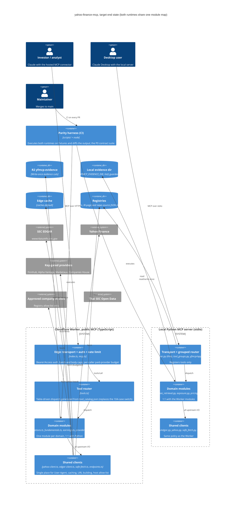
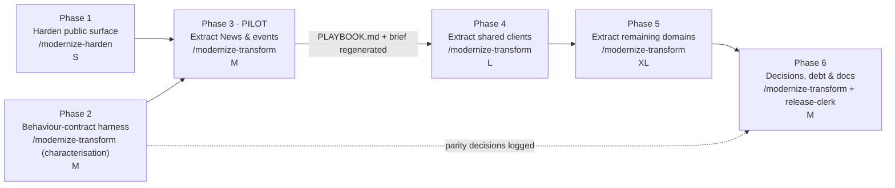

# Modernization Brief — yahoo-finance-mcp

**Status: DRAFT, awaiting approval (§8).** This document is the executable plan. The execution commands read it, and they treat each phase's scope, entry criteria and exit criteria as binding gates. **To steer execution, edit this file.** An edited entry criterion is honoured; a note in chat is not.

Built 2026-10-14 at `ab30388`/`c74d954` (release 2.5.33). No earlier brief exists, so this is the first version. Inputs (UTC modification times):

| Input | Produced by | Modified |
|---|---|---|
| `PREFLIGHT.md` (owner answers, scope boundary) | `/modernize-preflight` | 2026-10-14 11:01 |
| `ASSESSMENT.md`, `ARCHITECTURE.mmd` | `/modernize-assess` | 2026-10-14 11:01 |
| `topology.json`, `call-graph.mmd`, `data-lineage.mmd`, `critical-path.mmd` | `/modernize-map` | 2026-10-14 11:13 (`topology.json` regenerated, identical content, 21:27) |
| `BUSINESS_RULES.md`, `DATA_OBJECTS.md`, `rules.json` | `/modernize-extract-rules` | 2026-10-14 21:27 |
| `DELTA_CATALOG.md` | not required: the target keeps the same languages and versions (see §1) | — |

**Binding constraints from PREFLIGHT.md (owner answers, verbatim):**
- Scope: "complete system". No external consumers inside the repo. The external contract is the public MCP tool surface.
- Builds and tests run locally, with CI at "about 3-4 mins".
- Bespoke build infrastructure: "no".
- Prior attempts: "no".
- The confirmed off-limits list applies to every phase:
  - Lockfiles are regenerated by tools only.
  - The `wrangler.toml` build stamps stay empty.
  - The IR registry is owned by its bot workflow.
  - Frozen public contract: `tool_catalog.json`, `tool_groups.py`, `public_tool_contract.py`, `deployed_canaries.json`, the envelope.
  - Fixtures are the equivalence oracle.
  - The deploy workflow and version files change only through `release-clerk`.
  - Python and TS always change together.

---

## 1. Objective

Move yahoo-finance-mcp from **two parallel god files** (`server.py`, 12.5k lines; `worker/src/yahoo-finance.ts`, 17.8k lines) to **matching 1:1 domain modules in both runtimes**. The modules sit behind shared, policy-enforcing clients (one EDGAR client, one Yahoo client, one allow-listed fetcher), with an **execute-both parity harness** proving the two runtimes give identical output. Nothing changes in the public MCP contract, the languages or the runtime versions. Python 3.11 and the TypeScript Cloudflare Worker stay. That makes this a **same-stack Refactor, not a version uplift**, so no delta catalog applies.

Why now:
- The public Worker currently has two High findings: an open SSRF fetch proxy, and an unauthenticated `/mcp` that spends paid API-key quota.
- Every release already pays the god-file tax. Release 2.5.33 chased a retired Yahoo endpoint through both runtimes by hand.
- Today the parity net is strong only in the modules already extracted.
- 55 code-vs-docs or Python-vs-TS defects surfaced during rule extraction, 33 of them parity breaks.
- Local CI takes 3–4 minutes and the full test suite runs in this environment, so the codebase is unusually cheap to refactor safely right now.

## 2. Target Architecture



| Legacy component | Target component(s) | Phase |
|---|---|---|
| `worker/src/index.ts`, `mcp.ts` (no auth, unbounded batches) | Edge with auth, rate limit, batch and body caps | 1 |
| `parsePublicTranscript` / `indexEarningsRelease` / `fetchPublicHtml` (TS); `_fetch_public_html` (Py) | `safe-fetch.ts` / `yfmcp/clients/safe_fetch.py` (host allow-list, manual redirects) | 1 |
| `yfmcp/evidence_store.py` `list()` | Same file with a prefix guard | 1 |
| Source-text parity assertions (~209), per-module node harnesses | Parity harness: execute both runtimes on fixtures, P0 contract suite | 2 |
| `server.py#news` (2.8k) + `yahoo-finance.ts#news` (3.3k) | `yfmcp/news.py` + `worker/src/news.ts` (**pilot**) | 3 |
| `server.py#shared` (1.9k), `yahoo-finance.ts#shared` (1.7k), inline Yahoo client (`yahoo-finance.ts` 555–1370), TS EDGAR client (5082–5700), HTML/table parsing (5699–6280), ~26 hardcoded URL variants | `yahoo-client`, `edgar-client`, `html`, `endpoints` modules per runtime | 4 |
| Python SEC filing tools using raw `urlopen` (`server.py:3962–4256`) | Routed through `yfmcp/clients/edgar.py` | 4 |
| `server.py` / `yahoo-finance.ts` regions for SEC retrieval, extractors/exposure, pricing/options, fundamentals, providers, valuation wrappers, earnings | `sec_retrieval`, `exposure`, `pricing`, `options`, `fundamentals`, `providers`, `earnings` modules per runtime | 5 |
| `server.py:11938–12388` evidence-pack orchestration | `yfmcp/evidence_pack.py` (mirrors `evidence-pack.ts`) | 5 |
| `yfmcp/tools/earnings.py` back-calls via `_server_attr(...)` | Direct imports from the extracted modules (cycle removed) | 5 |
| `_dispatchTool` 104-case switch (`tools.ts:2009`) | Table-driven router | 5 |
| Inline output schemas `tools.ts:632–1450` | `worker/src/schemas.ts` (mirrors `yfmcp/schemas.py`) | 5 |
| Python reading `worker/src/*.json` | Shared registry data dir read by both runtimes | 6 |
| `SMOKE_TICKER_CIK_FALLBACKS` in the production lookup | Test-only seam (planner decision) | 6 |
| `docs/provider-runtime-guidance.md` (append-only log) | Plus a current-state `docs/architecture.md` with the module map | 6 |

## 3. Phased Sequence

**Ordering principle.** This is a same-stack refactor of one deployable per runtime, so neither strangler-fig across services nor build-graph leaf-first over projects fits directly. The order is **leaf-first by coupling**: secure the public surface, build the safety net, prove the recipe on the least-coupled domain, then extract the shared hub that every other domain depends on, then the remaining domains, then clean up. The topology map supports this order. The news region has no P0 rules and no module on either side. The shared helper regions are imported by every domain, so extracting any domain before them creates imports back into the god files.

**Phase 3 is the pilot, and this brief is a hypothesis.** Phases 3–5 share one execution recipe (extract a domain pair, keep output byte-identical, prove it with the harness). The pilot takes one domain, News & public events, all the way through and writes `analysis/yahoo-finance-mcp/PLAYBOOK.md`. What the pilot surfaces is *expected* to revise this brief: a coupling the map missed, a fixture gap, a release-process cost per extraction. **Regenerating this brief after the pilot is the normal path, not a correction.**



Phases 1 and 2 are independent and can run in parallel. Sizes are relative shares of the production-code COCOMO-II index (≈ 261 over 59.1 KSLOC, from `ASSESSMENT.md`). **They rank phases against each other and are not durations.**

Every phase ships as PRs that follow the repo's `CLAUDE.md`: TS change first, then the `python-mirror` port, then parity tests, then a section in `docs/provider-runtime-guidance.md`, then a version bump through `release-clerk`, then a `live-verifier` check after deploy.

### Phase 1 — Harden the public surface
- **Command:** `/modernize-harden yahoo-finance-mcp`.
- **Scope:**
  - **S-01/S-04 (SSRF):** add a host allow-list and manual redirect re-validation in both runtimes, covering `parse_public_transcript` and `index_earnings_release`.
  - **S-02/S-03:** add auth to `/mcp`, a rate limit, batch and body caps, and a per-caller paid-provider budget.
  - **S-05:** guard the evidence-store `list()` prefix.
  - **S-07/S-09:** set workflow `permissions:`, add `npm ci --ignore-scripts`, pin actions to SHAs.
  - **S-10/S-11:** run `uv lock --upgrade-package …`, add `uv sync --frozen` in CI, bump wrangler, gate CI on pip-audit and npm audit.
  - **Out of scope:** any restructuring.
- **Entry criteria (all checkable):**
  - [ ] §7 Q2a (fetch allow-list scope) and Q2b (auth model) are ticked with a written decision in this file.
  - [ ] `main` CI is green on the current head.
  - [ ] S-01 and S-02 are reproduced as failing tests on the current code, in both runtimes where applicable.
- **Exit criteria:**
  - [ ] The new SSRF tests pass in both runtimes (redirect to `http://`, a non-allow-listed host, loopback, link-local).
  - [ ] An unauthenticated `/mcp` call is rejected. Authenticated canaries pass in `test_deployed_canaries.py`.
  - [ ] A batch of more than 10 entries returns `-32600`.
  - [ ] `pip-audit` and `npm audit --omit=dev` are clean (or documented exceptions), with no High findings left in the dev chain.
  - [ ] The 65-step acceptance suite is green. The live verifier confirms the deployed version.
- **Relative size: S** (<5% of the index; touches about 10 functions and the workflow files).
- **Risk: Medium.**
  - Risk 1: auth breaks existing MCP clients, including the connector in use today. *Mitigation:* a grace period with a token issued before enforcement, and the canaries updated in the same PR.
  - Risk 2: the allow-list blocks legitimate IR or transcript URLs. *Mitigation:* derive the allow-list from approved registry entries plus SEC/Yahoo, and log rejections as warnings for one release before failing closed.

### Phase 2 — Behaviour-contract harness (characterisation)
- **Command:** `/modernize-transform yahoo-finance-mcp`, characterisation step only (test-engineer). No production code changes, apart from consolidating the JS-number helpers if the harness needs one implementation.
- **Scope:**
  - Extend the existing execute-both pattern (e.g. the esbuild harness in `scripts/test_filing_search.py`) into one parity harness that drives both runtimes from the same fixtures for **every P0 rule in §5**, plus the 33 parity-tagged defects in `BUSINESS_RULES.md` §3, which are recorded as *current* behaviour.
  - Record `analysis/yahoo-finance-mcp/BASELINE.md`: acceptance suite results, CI timing, harness coverage per domain, and the list of known divergences pinned as expected.
- **Entry criteria:**
  - [ ] `BUSINESS_RULES.md` exists (it does, with 455 rules and 84 P0).
  - [ ] §7 Q1 is ticked: the 6 P0 rules below High are confirmed or corrected by the owner.
  - [ ] Node is available to CI (it is: `ci.yml` installs Node 24).
- **Exit criteria:**
  - [ ] Every P0 rule ID in §5 maps to at least one harness case that runs both runtimes and diffs the output. The mapping table is in `BASELINE.md`.
  - [ ] Each known divergence is pinned with an explicit expected-difference assertion and its `BR-` ID, so it cannot drift silently.
  - [ ] The harness runs inside the 65-step CI and adds less than 2 minutes, keeping CI under about 6 minutes.
  - [ ] `BASELINE.md` is committed.
- **Relative size: M** (test code over the P0-heavy domains: extractors, valuation and SEC, about 35% of the index, but tests only).
- **Risk: Low.**
  - Risk 1: TS functions buried inside `yahoo-finance.ts` are hard to call in isolation. *Mitigation:* use the esbuild bundle-and-call pattern already in `scripts/`. Where a function isn't exported, test at the tool-call boundary.
  - Risk 2: duplicated P0 cards (e.g. the LTM rule extracted 5 times) inflate the suite. *Mitigation:* one harness case per behaviour, tagged with every matching `BR-` ID.

### Phase 3 — PILOT: extract News & public events
- **Command:** `/modernize-transform yahoo-finance-mcp`, unit: News & public events.
- **Scope:** move the functions in `server.py#news` and `yahoo-finance.ts#news` into `yfmcp/news.py` and `worker/src/news.ts`. The tools are `get_company_news`, `search_company_news`, `get_company_press_releases`, `get_public_event_timeline`, `get_sec_recent_events` and `verify_company_event`. `get_uk_company_filings` moves to providers in Phase 5. **Output must be byte-identical.** Shared helpers they call stay imported from the god files for now (to be cut in Phase 4).
- **Entry criteria:**
  - [ ] Phase 1 exit criteria are met.
  - [ ] Phase 2 exit criteria are met, and `BASELINE.md` shows harness coverage for the news tools (envelope, sourceStatus, coverage, dedupe) on fixtures.
  - [ ] §7 Q7 is answered for news. News has only 10 extracted rules, so either accept that or run a targeted extraction first.
- **Exit criteria:**
  - [ ] Neither god file contains a `#news` region any more (re-run `extract_topology.py`, which must show 0 NLOC for both).
  - [ ] Harness and acceptance suite are green. Deployed canaries pass. The live verifier reports identical output on its ticker list.
  - [ ] `analysis/yahoo-finance-mcp/PLAYBOOK.md` is written: the recipe, release-process steps, pitfalls, and the import-back list for Phase 4.
  - [ ] This brief is regenerated with the pilot's findings and re-approved for Phase 4.
- **Relative size: M** (about 6.1 KSLOC, about 10% of the index).
- **Risk: Medium.**
  - Risk 1: news helpers turn out to be more entangled with shared helpers than the map shows. *Mitigation:* allow imports back into the god files during the pilot and record them for Phase 4.
  - Risk 2: release overhead per extraction (version bump, docs section, live verification) dominates. *Mitigation:* the pilot measures it, and Phase 4/5 batching is decided in the regenerated brief (§7 Q9).

### Phase 4 — Extract the shared clients (the hub)
- **Command:** `/modernize-transform yahoo-finance-mcp`, units: Yahoo client, EDGAR client, HTML/table parsing, endpoint builder. The first unit in this phase is the **EDGAR client**, which serves as this phase's own pilot slice.
- **Scope:**
  - Move `server.py#shared` and `yahoo-finance.ts#shared` into shared client modules per runtime.
  - Move the TS Yahoo client (crumb, `yGet`, edge cache), the TS EDGAR client and the HTML parsing out of `yahoo-finance.ts`.
  - Add one endpoint-builder module per runtime (Debt #8).
  - Route the 5 Python SEC filing tools through `yfmcp/clients/edgar.py` (Debt #1). This **changes the User-Agent and caching** and is gated on §7 Q3a.
- **Entry criteria:**
  - [ ] Phase 3 exit criteria are met.
  - [ ] `PLAYBOOK.md` is approved, and the regenerated brief is approved for Phase 4.
  - [ ] §7 Q3a (accession-number divergence) is decided.
- **Exit criteria:**
  - [ ] The topology re-run shows no `#shared` region in either god file.
  - [ ] Every SEC fetch goes through one client per runtime (`grep` for raw `urlopen` and `fetch(` to `sec.gov` outside the client returns 0).
  - [ ] Harness, acceptance and canaries are green.
- **Relative size: L** (about 3.6 KSLOC of shared regions, plus about 2.5 KSLOC of TS client and parsing code, plus re-pointing every domain; about 15–20% of the index, but the highest fan-in).
- **Risk: High.**
  - Risk 1: every domain depends on these helpers, so a subtle change (caching, User-Agent, number formatting) breaks distant tools. *Mitigation:* run the full Phase 2 harness after each client move. Move one client per PR, EDGAR first.
  - Risk 2: Yahoo crumb and throttling behaviour regresses in production. *Mitigation:* keep `test_worker_yahoo_edge_cache.py` and `test_worker_yahoo_throttling.py` as gates, and have the live verifier run over the canary ticker list.

### Phase 5 — Extract the remaining domains
- **Command:** `/modernize-transform yahoo-finance-mcp`, one unit per domain, following `PLAYBOOK.md`.
- **Scope, in order:**
  1. SEC retrieval.
  2. Extractors/exposure. This includes the China-exposure duplication; any merge into a preset is behaviour-changing and gated on §7 Q5. Until then, move it as-is.
  3. Pricing/options.
  4. Fundamentals/analyst.
  5. Providers, including Companies House.
  6. Earnings: break the `_server_attr` cycle.
  7. Python evidence-pack orchestration, mirroring `evidence-pack.ts`.
  8. Then make the router table-driven and move the TS schemas to `schemas.ts`.

  `server.py` ends as a thin registration module, and `yahoo-finance.ts` is deleted or reduced to re-exports.
- **Entry criteria:**
  - [ ] Phase 4 exit criteria are met.
  - [ ] For each domain, its P0 rules in §5 are covered by the harness (already true after Phase 2), and any parity decision in §7 Q3 touching that domain is recorded.
- **Exit criteria, per domain:**
  - [ ] The region is gone from both god files (topology re-run).
  - [ ] The harness is green for that domain's P0 IDs, and the acceptance suite and canaries are green.
- **Exit criteria, for the phase:**
  - [ ] `server.py` has fewer than 1,000 lines.
  - [ ] `yahoo-finance.ts` is removed or under 500 lines.
  - [ ] The `_dispatchTool` switch is replaced by a table.
  - [ ] No function has CCN ≥ 100 in either runtime (lizard). Splitting functions is allowed only where the harness proves identical output.
- **Relative size: XL** (about 18 KSLOC of remaining god-file regions plus the router and schemas; about 30–35% of the index; holds 75 of the 84 P0 rules: SEC 7, extractors 27, valuation 36, earnings 5).
- **Risk: High.**
  - Risk 1: P0 dilution, valuation and fiscal-period logic shifts during the move. *Mitigation:* this is a move, not a rewrite. Keep the harness diff at zero for every P0 ID, and use one domain per PR.
  - Risk 2: Python and TS extractions drift apart mid-phase. *Mitigation:* `CLAUDE.md` order (TS first, then `python-mirror`, then parity tests) in the same PR. Never merge one runtime's half alone.

### Phase 6 — Decisions, debt and documentation
- **Command:** `/modernize-transform yahoo-finance-mcp` for code items. `release-clerk` handles releases.
- **Scope:**
  - Apply the parity and defect decisions ticked in §7 Q3/Q4/Q5. Each one is a separately released, deliberate behaviour change with its own docs section.
  - Move the registry JSON to a shared data dir (Python no longer reads `worker/src`).
  - Fix deprecated stdlib calls (Debt #9).
  - Audit swallowed errors (Debt #5; new warning codes are planner decisions).
  - Pin the MCP SDK and use public APIs (Debt #7, §7 Q8).
  - Remove stale docs (Debt #10).
  - Write `docs/architecture.md` with the module map, and replace the "79 tools" text.
- **Entry criteria:**
  - [ ] Phase 5 exit criteria are met.
  - [ ] Every behaviour change in scope has a ticked decision in §7.
- **Exit criteria:**
  - [ ] Each decided divergence's pinned expected-difference assertion in the harness is flipped to an equality assertion.
  - [ ] Topology re-run shows Python not reading `worker/src`.
  - [ ] `docs/architecture.md` is merged.
  - [ ] Acceptance suite, canaries and live verification are green.
- **Relative size: M** (many small items, about 10% of the index).
- **Risk: Medium.**
  - Risk 1: a "fix" changes output that clients rely on. *Mitigation:* each decision ships as its own versioned release with a docs section, never bundled with a refactor.
  - Risk 2: the swallowed-error audit adds warnings that change envelopes. *Mitigation:* new warning codes are planner-approved and added to the frozen-contract tests first.

## 4. Business Walkthroughs

### A. An investor checks a company's latest earnings and guidance
*Persona: investor using Claude with the hosted connector.* The investor asks for the latest quarterly results and management's outlook. The Worker finds the 8-K press release on SEC EDGAR, extracts the figures and guidance, and returns them with their source.

| Step (business language) | Implemented today by | Replaced in |
|---|---|---|
| Request arrives at the public endpoint | `worker/src/index.ts`, `mcp.ts` | **Phase 1** (auth, limits) |
| Router picks the earnings tool | `tools.ts` `_dispatchTool` | Phase 5 (table router) |
| Find the latest earnings press release on SEC | `yahoo-finance.ts#earnings`, `#sec` → SEC EDGAR | Phase 4 (EDGAR client), Phase 5 (earnings, SEC retrieval) |
| Pin the fiscal period it reports | `earnings-period.ts`, `fiscal-calendar.ts` | Unchanged (already modular); guarded by P0 BR-SEC-001…007 |
| Extract reported metrics and guidance | `extraction-rules.ts`, `guidance-history.ts` | Unchanged; guarded by P0 BR-EXT-010/014–017, BR-ERN-001…005 |
| Return the answer with source and warnings | `response.ts` | Unchanged (frozen envelope) |

### B. An analyst builds a valuation evidence pack
*Persona: equity analyst preparing a valuation.* The analyst asks for a citable evidence pack. The system assembles capital structure, dilution, guidance and consensus, stores an immutable evidence cut, and returns its id.

| Step | Implemented today by | Replaced in |
|---|---|---|
| Router picks the evidence tool | `tools.ts` | Phase 5 |
| Gather capital structure and dilution from filings | `evidence-pack.ts`, `capital-structure.ts`, `yahoo-finance.ts#extractors` → SEC | Phase 4 (EDGAR client), Phase 5 (extractors); Python orchestration `server.py:11938–12388` → `evidence_pack.py` in Phase 5; guarded by P0 BR-EXT-001…027 |
| Add analyst consensus and estimates | `yahoo-finance.ts#fundamentals`, `#providers` → Yahoo, Alpha Vantage | Phase 4 (Yahoo client), Phase 5; **Phase 1** adds the paid-provider budget; guarded by P0 BR-EVD-001…003 |
| Grade evidence quality and authority | `evidence.ts` | Unchanged |
| Store an immutable evidence cut | `evidence-store.ts` → R2 | Unchanged in the Worker; Python `list()` guard in **Phase 1**; guarded by P0 BR-EVD-004/005 |
| Return the pack and cut id | `response.ts` | Unchanged |

### C. A desktop user asks what's new about a company
*Persona: Claude Desktop user running the local server.* On their own machine, the user asks for recent news. The local Python server gathers Yahoo, newswire, approved IR pages and optional Finnhub/Marketaux items, de-duplicates them and reports coverage.

| Step | Implemented today by | Replaced in |
|---|---|---|
| Local server receives the request over stdio | `server.py#transport`, `yfmcp/app.py` | Phase 5 (thin `server.py`) |
| Grouped router resolves news_events | `tool_groups.py` | Unchanged (frozen contract) |
| Collect items from each source | `server.py#news` → Yahoo, newswire RSS, Finnhub, Marketaux | **Phase 3 pilot** → `yfmcp/news.py` |
| Check approved company IR pages | IR registry + company IR sites | Phase 1 (allow-listed fetch), Phase 6 (shared registry dir) |
| Wrap results in the standard envelope | `yfmcp/envelope.py` | Unchanged |

### D. A maintainer ships a new release
*Persona: repository owner merging to main.* A merge uploads an immutable candidate Worker version, verifies it with contract canaries, then promotes it and re-verifies production.

| Step | Implemented today by | Replaced in |
|---|---|---|
| Deploy job starts on merge | `.github/workflows/deploy-worker.yml` | **Phase 1** (permissions, `--ignore-scripts`, SHA pins); otherwise off-limits |
| Check tool lists and version contract | `scripts/check_tool_sync.py` | Phase 2 adds the parity harness to CI |
| Stamp build identity | `scripts/stamp_worker_build.py` → `wrangler.toml` vars | Unchanged (off-limits) |
| Upload candidate, verify canaries, promote | `scripts/worker_version_promotion.py` | Unchanged; canaries updated for auth in Phase 1 |

## 5. Behaviour Contract

These are the **84 P0 rules** from `BUSINESS_RULES.md` §2. In this system, P0 means the integrity of published figures. Each phase must prove these equivalent, in **both runtimes**, before it ships. Several cards describe the same behaviour from different files (e.g. the LTM formula appears 5 times), so the Phase 2 harness implements them as about 45 distinct behaviours tagged with every matching ID.

| Domain | P0 rule IDs | What they guard |
|---|---|---|
| Pricing (3) | BR-PRC-001 completed-session bar · BR-PRC-002 ⚠ price freshness · BR-PRC-003 listing currency → USD with minor units | Which price is "current", and its currency |
| SEC retrieval (7) | BR-SEC-001 fiscal-year naming offset · 002/003 equivalent-concept selection by newest filing · 004 filing period `latest`/fiscal year · 005/006/007 fiscal year of a period end (52/53-week drift) | Which fiscal period a figure belongs to |
| Extractors & capital structure (27) | BR-EXT-001/002 conversion-ratio units · 003 convertible if-converted and principal basis · 004 convertible preferred · 005/013 net-share settlement · 006 debt instrument status · 007/008 dilution bridge formula and status · 009 geographic revenue table · 010 guidance basis · 011 if-converted shares · 012 instrument-to-total-debt reconciliation · 014 outlook table scale · 015 ⚠ release figure scale and loss sign · 016/017 reported metric acceptance · 018–021 share-scenario mechanics · 022 short-term investments cross-check · 023 total-debt hierarchy · 024 treasury-stock / if-converted mechanics · 025 RSU/PSU gross · 026/027 warrant retirement and exercisable count | Share counts, dilution, debt and reported figures |
| Valuation & reconciliation (36) | BR-VAL-001…004 ⚠(004) ADR ratio and share basis · 005 filing vs Yahoo balances · 006 ⚠ historical balances at cash date · 007–010 historical market cap/EV/multiples · 011 point-in-time share count · 012/013/028 split-adjusted historical price · 014–018 LTM = LFY + YTD − prior YTD · 019–022 ⚠(022) metric reconciliation status and tolerance · 023/024/031 currency comparability · 025 ⚠ parent net income less NCI · 026/027/029/030 point-in-time fact precedence · 032–034 SEC vs Yahoo balance guards · 035/036 share-basis mismatch fallback | Enterprise value, multiples, LTM figures, reconciliation verdicts |
| Earnings (5) | BR-ERN-001 actual vs estimate period alignment · 002/003 guidance amount scaling · 004 guidance extraction status · 005 reported-actuals period labelling | Guidance amounts and periods |
| Evidence (5) | BR-EVD-001…003 consensus provider agreement · 004 evidence cut integrity verification · 005 write-once storage lifecycle | Integrity of stored evidence |
| Shared (1) | BR-SHR-001 decision-grade SEC XBRL fact | When a figure is presented as decision-grade |

**Blockers: P0 rules with confidence below High.** Their phase cannot start until the owner confirms or corrects them (§7 Q1):
- **BR-PRC-002** daily price freshness classification (Phase 2 harness, Phase 5 pricing).
- **BR-EXT-015** release figure scale and loss sign (Phase 5 extractors).
- **BR-VAL-004** ADR ratio detection and share-basis mismatch (Phase 5 valuation).
- **BR-VAL-006** historical balances at the cash date, where "no borrowings" means zero debt (Phase 5 valuation).
- **BR-VAL-022** metric source reconciliation status (Phase 5 valuation).
- **BR-VAL-025** parent net income derived from ProfitLoss less NCI (Phase 5 valuation).

**P0 rules with a known parity or doc defect.** These are preserved as-is and pinned in the harness until §7 Q3 decides them:
- **BR-EXT-003:** in-the-money is `>=` for convertibles but `>` for options and warrants.
- **BR-VAL-019:** a NaN tolerance clamps to 0% instead of 0.5% in Python.
- **BR-VAL-020:** the Worker's tool description says "AGREED = two or more providers agree", but the code requires an SEC baseline.

## 6. Validation Strategy

| Phase | Validation | Why |
|---|---|---|
| 1 Harden | **Security regression tests** (new, both runtimes), the **acceptance suite**, and **contract canaries** against candidate and production via the existing deploy gate; **live verifier** | Behaviour *intentionally* changes at the edge only. Tests must prove the attack paths are closed and the tool contract is unchanged |
| 2 Harness | **Characterisation tests** over fixtures, plus **dual execution** (Python vs TS diff). Known divergences are pinned as expected differences | Turns today's behaviour, defects included, into the oracle every later phase is measured against |
| 3 Pilot | **Dual-execution diff = 0**, the acceptance suite, canaries, and a **live verifier** before/after comparison on its ticker list | A pure move. Byte-identical output is the proof, and the live check catches anything fixtures miss (news is volatile, so compare structure and coverage fields, not article text) |
| 4 Shared clients | Dual-execution diff = 0 over the **whole** harness after each client move; the cache and throttling suites; live verifier | Highest fan-in, so every domain is regression-tested on every move |
| 5 Domains | Per domain: dual-execution diff = 0 for its P0 IDs, plus the acceptance suite and canaries; **property-based tests** for the dilution, LTM and fiscal-year arithmetic, where fixtures are sparse | Where the P0 contract lives. Property tests cover edge cases (strike = price, 52/53-week years, Feb 29) that fixtures miss |
| 6 Decisions | Each decision flips its pinned divergence to an equality assertion; **manual UAT** by the owner on the changed tools; live verifier | Deliberate behaviour changes need a human to confirm the new output is the intended one |

No production telemetry is available (`ASSESSMENT.md`), so there is no parallel-run comparison against real traffic. The live verifier's ticker list and the deployed canaries stand in. Exporting Workers logs (§7 Q10) would allow a before/after latency check on Phase 4.

## 7. Open Questions

Each must be ticked, with the decision written beside it, before the phase that names it starts.

- [ ] **Q1 (gates Phase 2).** Confirm or correct the 6 P0 rules below High: BR-PRC-002, BR-EXT-015, BR-VAL-004, BR-VAL-006, BR-VAL-022, BR-VAL-025. Each card in `BUSINESS_RULES.md` states its exact question.
- [ ] **Q2a (gates Phase 1).** Fetch allow-list scope for `parse_public_transcript` and `index_earnings_release`. The proposal is SEC Archives, Yahoo transcript URLs, and hosts of `approved` IR-registry entries only. Keep `raw_text` input as the escape hatch for anything else?
- [ ] **Q2b (gates Phase 1).** Auth model for `/mcp`: a static bearer token, Cloudflare Access, or OAuth. Also: the rate-limit key, and whether anonymous callers may ever force paid providers (`sources:["marketaux"]`).
- [ ] **Q3 (gates the phase that touches each).** Parity and defect decisions from `BUSINESS_RULES.md` §3. The default is **preserve current behaviour**. Tick only the ones to change in Phase 6:
  - [ ] Q3a `accession_number`: Python honours it, the Worker ignores it (Debt #1, gates Phase 4).
  - [ ] Q3b Worker `validateTicker` is called only by `get_historical_prices` (BR-ENV-007), and the Worker has no accession check (BR-ENV-005).
  - [ ] Q3c volume ratio at zero volume: Python null vs Worker 0/LOW (BR-PRC-033). Worker-only batch cap of 5 (BR-SHR-006).
  - [ ] Q3d price-target rounding: half-even vs `toFixed`, and `dataDate` fallback (BR-PRC-022).
  - [ ] Q3e reconciliation tolerance clamp: NaN/inf (BR-VAL-019/063), and the Worker's AGREED description (BR-VAL-020).
  - [ ] Q3f in-the-money `>=` vs `>` across instruments (BR-EXT-003/083).
  - [ ] Q3g valuation inputs: yfinance `.info` (Python) vs raw quoteSummary (Worker), and the unused `market_inputs_from_quote_summary`.
  - [ ] Q3h `sources=[]` default substitution drift in `sourceStatus` (Debt #2).
  - [ ] Q3i the remaining non-parity defects (beat streak order, Form 4 first-line only, Feb 29 date arithmetic, `NT$`/`A$` labelled USD, credit tier for loss-makers, CAGR on short histories, …): fix in Phase 6 or leave.
- [ ] **Q4 (Phase 6).** Remove `SMOKE_TICKER_CIK_FALLBACKS` from the production lookup chain (changes the fallback order)?
- [ ] **Q5 (Phase 5/6).** `extract_china_exposure` hardcodes one issuer's subsidiaries (Tongmei/JinMei/BoYu). Keep it, turn it into a data-driven preset over `extract_exposure`, or deprecate it?
- [ ] **Q6 (whole plan).** Keep both runtimes? This brief assumes **yes**, because local stdio users depend on Python. Retiring one would roughly halve the code, but it is a separate Rearchitect decision.
- [ ] **Q7 (Phase 3, Phase 5).** Rule-extraction coverage stopped at 4 rounds before running dry. News (10 rules), fundamentals (11) and providers (11) are thin. Accept that, or run a targeted `/modernize-extract-rules` on each before its phase?
- [ ] **Q8 (Phase 6).** Pin the MCP SDK to one major version (1.x or 2.x)?
- [ ] **Q9 (after the pilot).** Release cadence for pure-refactor PRs. Does every extraction get its own version bump, docs section and live verification per `CLAUDE.md`, or may several no-behaviour-change extractions share one release?
- [ ] **Q10 (optional).** Export Cloudflare Workers invocation logs to give Phase 4 a latency baseline.

## 8. Approval Block

```
Approved by: ________________  Date: __________
Approval covers: Phase 1 only | Full plan
```

Recommended: approve **Phases 1–3 only**. The pilot (Phase 3) is designed to revise this brief, so Phases 4–6 should be approved against the regenerated version.
