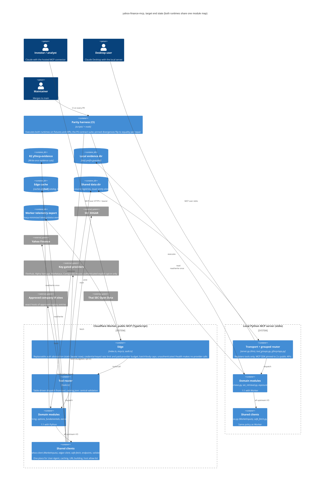
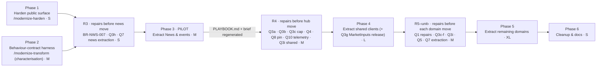

# Modernization Brief — yahoo-finance-mcp

**Status: DRAFT v2, owner decisions applied, NOT YET APPROVED (§8).** This document is the executable plan. The execution commands read it, and they treat each phase's scope, entry criteria and exit criteria as binding gates. **To steer execution, edit this file.** An edited entry criterion is honoured; a note in chat is not.

v2 (2026-10-15) folds in the owner's answers to every v1 open question. The source is `OWNER_DECISIONS_20261015.md`; my verification of its claims against the code is summarised in §7. Per that document, the next governance step is **refining the Sniper Doctrine MCP contract** against these decisions, before any execution phase is approved. The Doctrine is not in this repository, and nothing here has been checked against it.

| Input | Produced by | Modified (UTC) |
|---|---|---|
| `PREFLIGHT.md` (owner answers, scope boundary) | `/modernize-preflight` | 2026-10-14 11:01 |
| `ASSESSMENT.md`, `ARCHITECTURE.mmd` | `/modernize-assess` | 2026-10-14 11:01 |
| `topology.json`, `call-graph.mmd`, `data-lineage.mmd`, `critical-path.mmd` | `/modernize-map` | 2026-10-14 11:13 (`topology.json` regenerated, identical content) |
| `BUSINESS_RULES.md`, `DATA_OBJECTS.md`, `rules.json` | `/modernize-extract-rules` | 2026-10-14 21:27 (rules.json, verbatim) |
| `OWNER_DECISIONS_20261015.md`, `rule_overrides.json` → regenerated `BUSINESS_RULES.md` | owner, applied 2026-10-15 | 2026-10-15 |
| `DELTA_CATALOG.md` | not required: no language or runtime version changes (§1) | — |

**Binding constraints from PREFLIGHT.md (owner answers, verbatim):**
- Scope: "complete system". The external contract is the public MCP tool surface.
- Builds and tests run locally; CI takes "about 3-4 mins".
- Bespoke build infrastructure: "no".
- Prior attempts: "no".
- The confirmed off-limits list applies to every phase:
  - Lockfiles are regenerated by tools only.
  - The `wrangler.toml` build stamps stay empty.
  - The IR registry is owned by its bot.
  - Frozen public contract: `tool_catalog.json`, `tool_groups.py`, `public_tool_contract.py`, `deployed_canaries.json`, the envelope. Every addition below is a deliberate, versioned contract change.
  - Fixtures are the equivalence oracle.
  - The deploy workflow and version files change only through `release-clerk`.
  - Python and TS always change together.

---

## 1. Objective

Move yahoo-finance-mcp from **two parallel god files** (`server.py`, 12.5k lines; `worker/src/yahoo-finance.ts`, 17.8k lines) to **matching 1:1 domain modules in both runtimes**. The modules sit behind shared, policy-enforcing clients (one EDGAR client, one Yahoo client exposing a normalised `MarketInputs` contract, one allow-listed fetcher, one validation module), with an **execute-both parity harness** proving the two runtimes agree. Python 3.11 and the TypeScript Cloudflare Worker both stay (Q6). The MCP SDK stays on its current major, **2.x** (`mcp` 2.2.0 in `uv.lock`; Q8). This is a **same-stack Refactor plus a governed set of correctness repairs**, not a version uplift.

**Controlling principle (owner decision, verbatim):**
> Pure restructuring preserves behavior. A confirmed Doctrine-critical correctness defect is repaired before, or in the same governed release as, the phase that would otherwise preserve/fossilize it.

**How this brief applies it:**
- Every move PR is byte-identical.
- Every decided repair ships as its **own release, before the phase that moves its domain**, so moves and behaviour changes never share a diff.
- Until the Doctrine defines its "Doctrine-critical" class, the operative repair set is Q1's scheduled repairs plus Q2–Q5 and Q3a–Q3i (§7, resolution R2).

**Why now:**
- Two High security findings on the public Worker: an open SSRF fetch proxy, and an unauthenticated `/mcp` spending paid quota.
- The god-file tax on every release.
- A parity net that is strong only where code was already extracted.
- 55 code-vs-docs or Python-vs-TS defects found during rule extraction.
- 3–4 minute local CI that makes safe refactoring cheap.

## 2. Target Architecture



| Legacy component | Target component(s) | When |
|---|---|---|
| `worker/src/index.ts`, `mcp.ts` (no auth, unbounded batches, `Access-Control-Allow-Origin: *`) | Edge with an auth abstraction (static bearer), credential-keyed limits and budgets, batch/body caps, unauthenticated no-provider `/health` | Phase 1 |
| `parsePublicTranscript` / `indexEarningsRelease` / `fetchPublicHtml` (TS); `_fetch_public_html` (Py) | `safe-fetch` per runtime: HTTPS only, exact-host allow-list, every redirect re-validated, private/loopback/link-local/IP-literal rejected; `raw_text` never auto-fetches | Phase 1 |
| Default waterfalls that may call paid providers | Paid providers only with auth plus explicit caller opt-in; exhaustion returns a typed non-evidence state (Q2b, name per Q11) | Phase 1 |
| `yfmcp/evidence_store.py` `list()` | Prefix-guarded | Phase 1 |
| Source-text parity assertions; per-module node harnesses | Parity harness, P0 contract suite, pinned divergences | Phase 2 |
| News coverage FULL with failed sources (BR-NWS-007); `sources=[]` substitution drift | Repaired; explicit `sources=[]` = attempt none, with requested/attempted/skipped/defaulted metadata (Q3h) | R3 |
| `server.py#news` + `yahoo-finance.ts#news` | `yfmcp/news.py` + `worker/src/news.ts` (**pilot**) | Phase 3 |
| Worker ignores `accession_number` | Honoured with Python-equivalent fail-closed semantics (Q3a) | R4 |
| Ticker/accession validation scattered (Worker mostly unvalidated) | One validation module per runtime applied to every relevant action (Q3b) | R4 |
| Worker batch truncation at 5; Python unlimited | Advertised cap(s) in both runtimes per Q12 (10 on Paid, per-tool on Free), oversize rejected explicitly (Q3c) | R4 |
| `SMOKE_TICKER_CIK_FALLBACKS` in the production lookup (`yahoo-finance.ts:535`, `edgar.py:56`) | Test-only injected fixture (Q4, resolution R1) | R4 |
| No production telemetry | Privacy-minimised Worker telemetry export (Q10) | R4 |
| `mcp[cli]>=1.6.0,<3` with private-internals use | Pinned to `>=2.2,<3`, public APIs only (Q8) | R4 |
| `server.py#shared`, `yahoo-finance.ts#shared`, TS Yahoo client, TS EDGAR client, HTML parsing, ~26 hardcoded URL variants; Python SEC tools using raw `urlopen` | Shared `edgar-client`, `yahoo-client`, `html`, `endpoints` modules per runtime | Phase 4 |
| Valuation inputs from yfinance `.info` (Py) vs raw quoteSummary (TS) | One normalised `MarketInputs` contract owned by the Yahoo client (Q3g) | Phase 4, as its own release after the Yahoo-client move |
| Domain regions left in both god files; `_dispatchTool` switch; inline TS schemas; Python evidence-pack orchestration; `earnings.py` `_server_attr` cycle | Domain modules, table router, `schemas.ts`, `evidence_pack.py`, direct imports | Phase 5 |
| `extract_china_exposure` with hardcoded issuer aliases | Governed preset over `extract_exposure`; aliases in the shared data dir; public action kept (Q5) | R5-extractors, then moved in Phase 5 |
| Python reading `worker/src/*.json` | Shared data dir | Phase 6 |

## 3. Phased Sequence

**Ordering principle.** Leaf-first by coupling:
1. Secure the public surface.
2. Build the safety net.
3. Repair what the next move would otherwise fossilise.
4. Prove the move recipe on the least-coupled domain.
5. Extract the shared hub.
6. Extract the remaining domains.
7. Clean up.

**Two kinds of change, never mixed in one PR:**
- **Move PRs** (Phases 3–5): byte-identical output. Harness diff = 0.
- **Repair releases** (stream R): a decided behaviour change. It flips the corresponding pinned divergence in the harness from "expected difference" to the new assertion, ships with its own docs section and version bump, and goes through `CLAUDE.md`'s planner gate for any new field, enum, warning code or `unresolvedReason` (names in §7 Q11).

**Release cadence (Q9):**
- One domain or unit per PR.
- Security, shared-client, SEC, valuation and earnings changes get isolated releases.
- After the pilot, several small, disjoint, byte-identical move PRs may share one deployed release, provided each PR independently shows zero prohibited parity delta and the combined candidate reruns the full acceptance, parity and canary suite.
- Every deployed release gets one version bump, a docs entry, a convergence check and live verification.

**Phase 3 is the pilot, and this brief is a hypothesis.** The pilot takes News & events all the way through and writes `PLAYBOOK.md`. What it surfaces is *expected* to revise this brief. **Regenerating the brief after the pilot is the normal path.**



Phases 1 and 2 are independent and may run in parallel. Sizes are relative shares of the production-code COCOMO-II index (≈ 261 over 59.1 KSLOC, from `ASSESSMENT.md`). **They rank phases against each other and are not durations.**

Every PR follows `CLAUDE.md`: the TS change first, then the `python-mirror` port, then parity tests, then a section in `docs/provider-runtime-guidance.md`, then `release-clerk`, then `live-verifier` after deploy.

### Phase 1 — Harden the public surface
- **Command:** `/modernize-harden yahoo-finance-mcp`.
- **Scope:**
  - **Q2a:** strict HTTPS allow-list. SEC Archives and approved SEC endpoints, the exact Yahoo hosts needed by the transcript and news workflows, and the exact hosts of IR-registry entries with status `approved`. Every redirect hop is re-validated. Private, loopback, link-local and IP-literal destinations are rejected. No wildcards. `raw_text` is caller content only and never auto-fetches. This also covers the earnings-release URL policy (BR-ERN-017).
  - **Q2b:** `/mcp` requires a static bearer token behind a replaceable auth abstraction. Rate limits and provider budgets are keyed by credential, not IP. An unauthenticated `/health` may exist only if it makes no provider calls. Paid providers need auth **and** explicit caller opt-in, and default waterfalls never force them. Budget exhaustion returns a typed non-evidence state, never `NOT_FOUND`.
  - **S-03:** JSON-RPC batch cap and body cap (the batch cap value follows Q12).
  - **Per-invocation subrequest budget guard (V3, required on any plan):** count `fetch()` and Cache API calls in the request scope against the plan limit, stop starting new upstream work before the limit, and mark the affected sources `PROVIDER_BUDGET_EXHAUSTED`, never `PROVIDER_ERROR` or clean absence. Production already exceeds Free's 50 (V3).
  - **S-05:** evidence-store `list()` guard.
  - **S-07/S-09:** workflow permissions, `--ignore-scripts`, actions pinned to SHAs.
  - **S-10/S-11:** dependency upgrades, `uv sync --frozen`, audit gates.
  - **S-13:** restrict CORS once auth exists.
- **Entry criteria:**
  - [ ] §7 Q12 is decided (plan strategy and batch-cap values).
  - [ ] §7 V1 is verified: every client in use (the claude.ai connector, Claude Desktop, deploy canaries, the live verifier) can send a static `Authorization` header, or a fallback is recorded here.
  - [x] §7 Q11 names confirmed (2026-10-15): `AUTH_REQUIRED`, `BATCH_LIMIT_EXCEEDED`, `PROVIDER_BUDGET_EXHAUSTED`, `PROVIDER_OPT_IN_REQUIRED`.
  - [ ] The owner acknowledges §7 V2: with **0 approved IR entries** today, company-IR URL fetches are refused until entries are approved.
  - [ ] `main` CI is green.
  - [ ] S-01 and S-02 are reproduced as failing tests in both runtimes.
- **Exit criteria:**
  - [ ] SSRF tests pass in both runtimes (http redirect, non-allow-listed host, loopback, link-local, IP literal, `raw_text` containing a URL is not fetched).
  - [ ] Unauthenticated `/mcp` is rejected with the confirmed code. Authenticated canaries pass. `/health` makes zero provider calls (asserted).
  - [ ] Anonymous or no-opt-in calls make zero paid-provider requests (asserted with a fetch spy). Exhaustion returns the typed state.
  - [ ] Audits are clean or have documented exceptions. The acceptance suite is green. The live verifier confirms.
- **Relative size: S.**
- **Risk: Medium.**
  - Risk 1: auth locks out a client that can't send headers. *Mitigation:* V1 gate, plus a token-issued grace release before enforcement.
  - Risk 2: the allow-list blocks legitimate URLs (the IR registry is empty). *Mitigation:* `raw_text` escape hatch, plus approving registry entries through the existing bot and review flow.

### Phase 2 — Behaviour-contract harness (characterisation)
- **Command:** `/modernize-transform yahoo-finance-mcp`, characterisation step only.
- **Scope:**
  - One parity harness that drives both runtimes from the same fixtures for every P0 rule in §5 (about 45 distinct behaviours).
  - Every decided-repair item (35 rules tagged in `BUSINESS_RULES.md` §3, plus Q3a/Q3h/Q4 behaviours) is pinned as **current** behaviour, with an assertion tagged by its decision ID. The repair release flips it later.
  - Record `BASELINE.md`.
- **Entry criteria:**
  - [x] `BUSINESS_RULES.md` has the 6 P0 cards corrected per Q1 (done 2026-10-15; all 84 P0 cards are now High confidence).
  - [ ] Node is available in CI (it is).
- **Exit criteria:**
  - [ ] Every P0 ID maps to at least one execute-both case; the table is in `BASELINE.md`.
  - [ ] Every repair-scheduled item has a pinned current-behaviour assertion carrying its decision ID.
  - [ ] The harness adds less than 2 minutes to CI.
  - [ ] `BASELINE.md` is committed.
- **Relative size: M.**
- **Risk: Low.**
  - Risk 1: buried TS functions are hard to call. *Mitigation:* the esbuild bundle-and-call pattern, or testing at the tool boundary.
  - Risk 2: duplicate P0 cards inflate the suite. *Mitigation:* one case per behaviour, tagged with all matching IDs.

### Stream R — Correctness repair releases
Each R-release is a set of **separately released** behaviour changes that must be live before the move it precedes. All follow the TS → Python mirror → parity flip → docs → version bump → live-verify order.

- **R3 (before Phase 3):**
  - BR-NWS-007: news coverage must not report `FULL` while required sources have failed (Q3i).
  - V3 news follow-through: sources starved by the subrequest budget are reported `PROVIDER_BUDGET_EXHAUSTED` and coverage states the budget cause. This is today's live MSFT 0-item case.
  - Q3h: `sources` omitted or null means the defaults; `sources=[]` means attempt none; requested, attempted, skipped and defaulted metadata kept separate; `sourceStatus` describes what actually happened.
  - **Q7:** targeted rule extraction for News (`/modernize-extract-rules` with a news `modulePattern`), with the new rules folded into Phase 2's harness.
- **R4 (before Phase 4):**
  - Q3a: the Worker honours exact `accession_number` with fail-closed semantics.
  - Q3b: central ticker and accession validation in both runtimes, on every relevant action, including the Python paths that skip it.
  - Q3c: advertised batch cap(s) with explicit oversize rejection: one cap of 10 if Q12 = Paid, the per-tool caps if Q12 = Free.
  - Q4: smoke-ticker table out of the production lookup.
  - Q8: pin `mcp>=2.2,<3` and replace private-internals use (`_tool_manager._tools`, the `FastMCP.tool` monkey-patch) with public APIs, failing loudly.
  - Q10: privacy-minimised telemetry export capturing a **baseline window before any Phase 4 merge**.
  - Q3i items in the SEC and shared domains (3 tagged in §3).
  - Q3i triage of the remaining 20 untagged defects, classified repair or preserve, with the result written into §7.
- **Phase 4 inner release:** Q3g, the `MarketInputs` contract. It ships right after the Yahoo-client move PR and before any valuation work.
- **R5-‹unit› (before each Phase 5 unit), the repairs tagged for that unit's domain in `BUSINESS_RULES.md` §3:**
  - **Pricing/options:** BR-PRC-002 exchange-session-aware freshness (adds a shared exchange-holiday calendar data file; V5), Q3c zero volume (ratio null, flag null/UNKNOWN, explicit warning), Q3d raw-ratio thresholds with deterministic display rounding and no synthesised `dataDate`, short-history CAGR.
  - **Fundamentals:** incomplete-TTM state, the negative-earnings-base credit state, newest-first beat streak.
  - **Extractors:** BR-EXT-015 monetary loss sign, Q3f inclusive `>=` (§7 V4), Feb 29 arithmetic, `NT$`/`A$` currency recognition, and Q5 China preset with aliases moved to data.
  - **Valuation:** BR-VAL-006 debt-group completeness, BR-VAL-025 unresolved parent income, Q3e tolerance NaN/inf handling and the AGREED wording, EV convertible-debt basis.
  - **Earnings:** transcript fallback ordering by sources actually attempted, surprise actuals per the source policy (resolution R3: official release first).
  - **Providers:** eligibility policy fails closed.
  - **Shared (Form 4):** multi-line parsing.
  - **Fundamentals and providers** each get a **Q7** targeted rule extraction before their R5 release.
- **Entry criteria (each R-release):**
  - [ ] Its pinned assertions exist (Phase 2).
  - [x] Any new name it introduces is confirmed in §7 Q11 (all accepted 2026-10-15; a name not in that table needs a new owner decision).
- **Exit criteria (each R-release):**
  - [ ] Its pinned assertions are flipped and pass in both runtimes.
  - [ ] The rest of the harness diff is 0.
  - [ ] The acceptance suite and canaries are green.
  - [ ] The docs section is merged and the live verifier confirms.
- **Relative size: M in total**, spread across the stream.
- **Risk: Medium.**
  - Risk 1: a repair silently changes output that downstream callers or the Doctrine rely on. *Mitigation:* isolated releases, documented field-level diffs, owner UAT.
  - Risk 2: repairs drift between runtimes. *Mitigation:* each repair flips an execute-both assertion, so both runtimes must change together.

### Phase 3 — PILOT: extract News & public events
- **Command:** `/modernize-transform yahoo-finance-mcp`, unit: News & public events.
- **Scope:**
  - Move the `server.py#news` and `yahoo-finance.ts#news` functions into `yfmcp/news.py` and `worker/src/news.ts`.
  - The tools are `get_company_news`, `search_company_news`, `get_company_press_releases`, `get_public_event_timeline`, `get_sec_recent_events` and `verify_company_event`. `get_uk_company_filings` moves with providers.
  - Output must be byte-identical. Imports back into the god files are allowed and recorded.
- **Entry criteria:**
  - [ ] Phase 1 and Phase 2 exit criteria are met.
  - [ ] R3 is released and live-verified.
  - [ ] The Q7 news rules are in the harness.
- **Exit criteria:**
  - [ ] The topology re-run shows 0 NLOC in both `#news` regions.
  - [ ] Harness diff = 0; acceptance suite and canaries green; the live verifier compares structure and coverage before and after.
  - [ ] `PLAYBOOK.md` is written.
  - [ ] This brief is regenerated and re-approved for R4 and Phase 4.
- **Relative size: M** (about 6.1 KSLOC, about 10%).
- **Risk: Medium.**
  - Risk 1: hidden coupling to the shared helpers. *Mitigation:* allow imports back, list them for Phase 4.
  - Risk 2: per-release overhead. *Mitigation:* the pilot measures it, and the Q9 batching rules apply after the pilot.

### Phase 4 — Extract the shared clients (the hub)
- **Command:** `/modernize-transform yahoo-finance-mcp`, units in order:
  1. EDGAR client (this phase's own pilot slice).
  2. Yahoo client.
  3. HTML/table parsing.
  4. Endpoint builder.

  The Q3g `MarketInputs` release ships between units 2 and 3.
- **Scope:**
  - Move the shared regions and the inline TS Yahoo/EDGAR clients and parsing into client modules.
  - Route the Python SEC filing tools through `yfmcp/clients/edgar.py`. This changes the User-Agent and adds caching; Q3a in R4 already aligned the accession semantics.
- **Entry criteria:**
  - [ ] Phase 3 exit criteria are met; `PLAYBOOK.md` and the regenerated brief are approved.
  - [ ] R4 is released.
  - [ ] **The telemetry baseline window is captured** (Q10).
- **Exit criteria:**
  - [ ] No `#shared` region remains.
  - [ ] Zero SEC fetches happen outside the client in either runtime (grep).
  - [ ] Q3g is released: both runtimes consume `MarketInputs`, and the unused helper is removed or repurposed only after fixtures prove the replacement.
  - [ ] Harness, acceptance and canaries are green.
  - [ ] Latency and error rates compared against the baseline show no regression beyond agreed bounds.
- **Relative size: L.**
- **Risk: High.**
  - Risk 1: the highest fan-in, so a subtle client change breaks distant tools. *Mitigation:* full harness after each unit, one client per PR.
  - Risk 2: Yahoo crumb and throttling regress. *Mitigation:* cache and throttling suites, telemetry comparison, live verifier.

### Phase 5 — Extract the remaining domains
- **Command:** `/modernize-transform yahoo-finance-mcp`, one unit per domain, following `PLAYBOOK.md`.
- **Scope, in order, each unit preceded by its R5 release:**
  1. SEC retrieval.
  2. Extractors/exposure.
  3. Pricing/options.
  4. Fundamentals/analyst.
  5. Providers, including Companies House.
  6. Earnings: remove the `_server_attr` cycle.
  7. Python evidence-pack orchestration.
  8. Table router and `schemas.ts`.
- **Entry criteria, per unit:**
  - [ ] Its R5 release is live.
  - [ ] Its P0 IDs are covered (Phase 2).
  - [ ] For fundamentals and providers, the Q7 extraction is folded in.
- **Exit criteria, per unit:** region gone (topology); harness diff = 0; acceptance and canaries green.
- **Exit criteria, for the phase:**
  - [ ] `server.py` has fewer than 1,000 lines.
  - [ ] `yahoo-finance.ts` is removed or under 500 lines.
  - [ ] The switch is replaced by a table.
  - [ ] No function has CCN ≥ 100 (lizard).
- **Relative size: XL** (holds 75 of the 84 P0 rules).
- **Risk: High.**
  - Risk 1: P0 logic shifts during the move. *Mitigation:* moves only, harness diff = 0 per P0 ID.
  - Risk 2: runtime drift mid-phase. *Mitigation:* the `CLAUDE.md` order inside one PR.

### Phase 6 — Cleanup and documentation
- **Command:** `/modernize-transform yahoo-finance-mcp`; `release-clerk`.
- **Scope:**
  - Shared data dir (Python stops reading `worker/src`).
  - Deprecated stdlib calls (Debt #9).
  - Swallowed-error audit (Debt #5; new warning codes via Q11).
  - Stale comments and the "79 tools" text (Debt #10).
  - `docs/architecture.md` with the module map.
  - Q3i items triaged as "preserve" get documented as intentional.
- **Entry criteria:**
  - [ ] Phase 5 exit criteria are met.
- **Exit criteria:**
  - [ ] Python reads nothing under `worker/src`.
  - [ ] `docs/architecture.md` is merged.
  - [ ] No pinned "expected difference" remains in the harness except documented intentional ones.
  - [ ] Acceptance suite, canaries and live verification are green.
- **Relative size: S.**
- **Risk: Low–Medium.**
  - Risk: new warning codes change envelopes. *Mitigation:* Q11 confirmation first, and frozen-contract tests updated in the same PR.

## 4. Business Walkthroughs

### A. An investor checks a company's latest earnings and guidance
*Investor using Claude with the hosted connector.* The Worker finds the 8-K press release on SEC EDGAR, extracts figures and guidance, and returns them with their source.

| Step | Implemented today by | Changed in |
|---|---|---|
| Request arrives at the public endpoint | `index.ts`, `mcp.ts` | **Phase 1**: bearer auth, limits; paid sources only on opt-in |
| Router picks the earnings tool | `tools.ts` `_dispatchTool` | R4 central validation; Phase 5 table router |
| Find the latest press release on SEC | `yahoo-finance.ts#earnings`, `#sec` | R4 (accession honoured); Phase 4 EDGAR client; Phase 5 move |
| Pin the fiscal period | `earnings-period.ts`, `fiscal-calendar.ts` | Unchanged; P0 BR-SEC-001…007 |
| Extract metrics and guidance | `extraction-rules.ts`, `guidance-history.ts` | R5-extractors (BR-EXT-015: monetary losses signed correctly); P0 BR-EXT-010/014–017, BR-ERN-001…005 |
| Compare with estimates | earnings surprise | R5-earnings (actuals per source policy R3) |
| Return with source and warnings | `response.ts` | Unchanged (frozen envelope) |

### B. An analyst builds a valuation evidence pack
*Equity analyst preparing a valuation.* The system assembles capital structure, dilution, guidance and consensus, stores an immutable evidence cut, and returns its id.

| Step | Implemented today by | Changed in |
|---|---|---|
| Router picks the evidence tool | `tools.ts` | Phase 5 |
| Capital structure and dilution from filings | `evidence-pack.ts`, `capital-structure.ts`, `yahoo-finance.ts#extractors` | R5-extractors (Q3f inclusive ITM boundary); Phase 4/5 moves; P0 BR-EXT-001…027 |
| Consensus and estimates | `#fundamentals`, `#providers` → Yahoo, Alpha Vantage | Phase 1 (paid only on opt-in, typed budget state); Phase 4 `MarketInputs` (Q3g); P0 BR-EVD-001…003 |
| Valuation figures | `valuation.ts`, `valuation-history.ts` | R5-valuation (debt-group completeness, unresolved parent income, EV convertible basis, Q3e) |
| Store an immutable cut | `evidence-store.ts` → R2 | Python `list()` guard in Phase 1; P0 BR-EVD-004/005 |

### C. A desktop user asks what's new about a company
*Claude Desktop user running the local server.*

| Step | Implemented today by | Changed in |
|---|---|---|
| Local request over stdio | `server.py#transport`, `yfmcp/app.py` | R4 (SDK 2.x public APIs); Phase 5 thin `server.py` |
| Grouped router resolves news_events | `tool_groups.py` | Unchanged |
| Collect from each source | `server.py#news` | **R3**: `sources=[]` means none, honest source metadata; **Phase 3 pilot** → `yfmcp/news.py` |
| Approved IR pages | IR registry + IR sites | Phase 1 allow-list; Phase 6 shared data dir |
| Report coverage | `_compute_source_coverage` | **R3**: no `FULL` while sources have failed (BR-NWS-007) |

### D. A maintainer ships a new release
*Repository owner merging to main.*

| Step | Implemented today by | Changed in |
|---|---|---|
| Deploy job on merge | `deploy-worker.yml` | Phase 1 (permissions, `--ignore-scripts`, SHA pins); otherwise off-limits |
| Tool and version contract checks | `check_tool_sync.py` | Phase 2 adds the parity harness |
| Candidate canaries, promote, re-verify | `worker_version_promotion.py`, canaries | Phase 1 canaries authenticate; R4 telemetry baseline; Q9 shared releases after the pilot |

## 5. Behaviour Contract

These are the **84 P0 rules** in `BUSINESS_RULES.md` §2 (data integrity of published figures), about 45 distinct behaviours. **All 84 are now High confidence**: the 6 previously uncertain cards were corrected by the owner (Q1) and **no P0 blockers remain**.

| Domain | P0 rule IDs | What they guard |
|---|---|---|
| Pricing (3) | BR-PRC-001 completed-session bar · 002 price freshness · 003 currency → USD with minor units | Which price is "current" |
| SEC retrieval (7) | BR-SEC-001…007 fiscal-year naming, equivalent-concept selection, filing period, 52/53-week fiscal year | Which period a figure belongs to |
| Extractors (27) | BR-EXT-001…027 conversion ratios, if-converted, preferred, net-share settlement, debt status, dilution bridge, geo revenue, guidance basis and scale, reported-metric acceptance, scenarios, total debt, RSUs, warrants | Share counts, dilution, debt, reported figures |
| Valuation (36) | BR-VAL-001…036 ADR/share basis, balances, historical EV and multiples, split-adjusted prices, LTM, reconciliation, currency comparability, parent net income, point-in-time precedence | EV, multiples, LTM, reconciliation verdicts |
| Earnings (5) | BR-ERN-001…005 | Guidance amounts and periods |
| Evidence (5) | BR-EVD-001…005 | Evidence integrity |
| Shared (1) | BR-SHR-001 | Decision-grade designation |

**P0 rules with a scheduled repair.** Pinned as current behaviour in Phase 2, then flipped by the named R-release before their domain moves:

| P0 rule | Repair | Release |
|---|---|---|
| BR-PRC-002 | Exchange-session-aware freshness; UNKNOWN when the prior session can't be established | R5-pricing |
| BR-EXT-015 | Monetary loss sign (e.g. "net loss of $5 billion" is no longer positive) | R5-extractors |
| BR-EXT-003 (and P1 scenario cards) | Inclusive `>=` across instruments; `inTheMoney` flips at the exact strike, incremental shares stay 0 | R5-extractors |
| BR-VAL-006 | Partial debt-group understatement | R5-valuation |
| BR-VAL-025 | Missing NCI gives unresolved or limited parent income, not raw ProfitLoss | R5-valuation |
| BR-VAL-019, BR-VAL-020 | NaN/inf tolerance falls back to 0.5% then clamps; Worker AGREED wording aligned | R5-valuation |

## 6. Validation Strategy

| Phase | Validation | Why |
|---|---|---|
| 1 Harden | Security regression tests (both runtimes); fetch-spy assertions for paid-provider and `/health` zero-calls; acceptance suite; authenticated canaries; live verifier | The edge changes intentionally; the attack paths and paid-provider leakage must be provably closed |
| 2 Harness | Characterisation tests plus dual-execution diff; pinned assertions per decision ID | Today's behaviour, defects included, becomes the oracle |
| R-releases | Pinned assertion flipped in both runtimes; rest of harness diff = 0; **property-based tests** for date and arithmetic repairs (Feb 29, 52/53-week, CAGR windows, ITM boundary); owner **UAT** on changed tools | Deliberate behaviour changes must be both exact and intended |
| 3 Pilot | Dual-execution diff = 0; acceptance; canaries; live verifier structural before/after | A pure move |
| 4 Shared clients | Full harness after each unit; cache and throttling suites; **telemetry before/after** (Q10) | Highest fan-in; runtime regressions only show up in production signals |
| 5 Domains | Per unit: diff = 0 for its P0 IDs; acceptance; canaries; property tests where fixtures are sparse | P0-heavy moves |
| 6 Cleanup | Acceptance, canaries, live verifier; frozen-contract tests for any new warning code | Low-risk tidy-up |

## 7. Open Questions — owner decisions (2026-10-15)

### Resolved by the owner (verbatim from `OWNER_DECISIONS_20261015.md`; Q8 literal filled)

- [x] **Q1 (gates Phase 2).** Six Medium-confidence P0 cards reviewed. Correct the behavior cards before Phase 2: BR-PRC-002 keeps CURRENT/STALE/UNKNOWN but target freshness is exchange-session-aware; BR-EXT-015 must describe the narrower current scale/sign logic; BR-VAL-004 must include inverse ADR detection, rounding and mismatch consequences; BR-VAL-006 must describe first-partially-tagged debt-group behavior and conditional US-GAAP zero-debt handling; BR-VAL-022 must reflect actual SEC-baseline/status/tolerance semantics; BR-VAL-025 must reflect chosen-ProfitLoss/NCI-match behavior. BR-VAL-025 raw-ProfitLoss fallback and other named unsafe behaviors are characterized for baseline but queued as correctness repairs. — *Applied 2026-10-15 via `rule_overrides.json`.*
- [x] **Q2a (gates Phase 1).** URL fetch allow-list = HTTPS SEC Archives/approved SEC endpoints + exact supported Yahoo hosts + exact hosts of `approved` IR-registry entries. Validate every redirect hop; reject private/link-local/loopback/IP-literal bypasses. Keep `raw_text` as caller-supplied-content escape hatch only; it never auto-fetches URLs.
- [x] **Q2b (gates Phase 1).** `/mcp` uses a static bearer token for this modernization behind a replaceable auth abstraction. Rate limits/provider budgets key from authenticated identity. Anonymous `/mcp` provider calls are not allowed. Paid providers require authenticated explicit opt-in; budget exhaustion is typed failure/non-evidence, never NOT_FOUND.
- [x] **Q3a.** CHANGE: Worker must honor exact `accession_number` with Python-equivalent fail-closed semantics before Phase 4.
- [x] **Q3b.** CHANGE: centralize ticker/accession validation and apply it consistently across both runtimes/public actions.
- [x] **Q3c.** CHANGE: zero-volume ratio/flag = null/UNKNOWN with explicit warning. Remove silent Worker truncation; one advertised cross-runtime batch cap, initially 10, with explicit oversize rejection.
- [x] **Q3d.** CHANGE: thresholds use unrounded raw values; display rounding is deterministic and cross-runtime; missing `dataDate` stays null and never falls back to today.
- [x] **Q3e.** CHANGE: NaN/inf tolerance -> documented 0.5% default before finite clamp; align AGREED definition to latest SEC + >=1 independent matching provider.
- [x] **Q3f.** CHANGE: use inclusive `>=` ITM boundary consistently across instrument classes; treasury-stock math still yields zero incremental option/warrant shares at exact strike.
- [x] **Q3g.** CHANGE: replace `.info` vs raw quoteSummary divergence with one normalized shared-client `MarketInputs` contract consumed by both runtimes.
- [x] **Q3h.** CHANGE: omitted/null `sources` uses defaults; explicit `sources=[]` means attempt none. Preserve requested/attempted/skipped/defaulted metadata separately.
- [x] **Q3i.** CHANGE confirmed semantic/data-integrity defects. Preserve only cosmetic/intentional compatibility differences. Doctrine-critical defects are repaired before or in the same governed release as the phase touching their domain.
- [x] **Q4.** Remove `SMOKE_TICKER_CIK_FALLBACKS` from production lookup; retain only as injected test fixtures. — *Scheduled in R4 (before Phase 4), not Phase 6: see R1 below.*
- [x] **Q5 (Phase 5/6).** Generalise `extract_china_exposure` into a governed preset over `extract_exposure`; move issuer-specific aliases to data/config. Keep the public compatibility action for now.
- [x] **Q6 (whole plan).** Keep both runtimes: Python local/stdio + hosted Worker. Runtime retirement is a separate rearchitecture decision.
- [x] **Q7 (Phase 3, Phase 5).** Run targeted rule extraction for News before Phase 3 and Fundamentals/Providers before their Phase-5 units.
- [x] **Q8.** Pin the currently deployed MCP SDK major and public APIs; do not perform a major-version uplift inside modernization. — *Observed from the repository: `uv.lock` resolves **`mcp` 2.2.0**, so the major is **2.x**; pin `mcp[cli]>=2.2,<3` (`pyproject.toml` currently allows `>=1.6.0,<3`). The Worker uses no MCP SDK (hand-written JSON-RPC handler in `worker/src/mcp.ts`).*
- [x] **Q9 (after pilot).** One domain/unit per PR. After the News pilot, multiple small disjoint behavior-identical refactor PRs may share a release if each has zero prohibited parity delta and the combined release reruns full acceptance/parity/canary tests. Every deployed release still receives one version bump, docs/release entry, convergence check and live verification.
- [x] **Q10.** Export privacy-minimized Worker operational telemetry before Phase 4 for latency/error baseline. Log action/domain, build identity, latency, provider-attempt/status class and response-size bucket; never log credentials, payload bodies, raw source content or caller raw_text.

### Resolutions of inconsistencies (proposed by the planner, accepted by the owner 2026-10-15)

- [x] **R1. Q4 timing.** The smoke-ticker table lives in the EDGAR client (`edgar.py:56`, `yahoo-finance.ts:535`), which moves first in Phase 4. Under the controlling principle, Q4 ships in **R4, before Phase 4**.
- [x] **R2. "Doctrine-critical" is not yet defined.** Until the Doctrine refinement defines the class, the operative repair set is the scheduled repairs from Q1 plus every Q2–Q5 and Q3a–Q3i item, each placed in the R-release before its domain moves. When the Doctrine definition lands, re-tag items and regenerate this brief.
- [x] **R3. "Governed source policy" for earnings-surprise actuals.** Use the **official issuer release figure first** (as revenue already does); Yahoo `epsActual` only as a labelled fallback when the release has no figure, never silently presented as official.

### Verification notes (planner checked the decisions against the code, 2026-10-15)

- **V1 (gates Phase 1).** A required static bearer token breaks any client that can't send a fixed `Authorization` header. Verify the claude.ai connector, Claude Desktop, the deploy canaries and the live verifier before enforcement.
- **V2 (acknowledge before Phase 1).** `worker/src/company-ir-page-registry.json` has **0 `approved` entries** (2 `candidate`). Under Q2a, company-IR URL fetches are refused until entries are approved; `raw_text` is the only route meanwhile.
- **V3 (gates the Q3c cap in R4): measured 2026-10-15; see `v3/V3_SUBREQUESTS.md`. Plan = Workers FREE (owner-confirmed).**
  - **Limits:** 50 subrequests per invocation; Cache API calls and redirect hops count. CPU is limited to 10 ms per request.
  - **Measured on reachable batch tools:** `analyze_credit_health` about 62 at n=10; `get_company_news` (defaults) about 61; `analyze_financial_ratios` about 42. Others stay at or under about 32.
  - **Already broken in production at today's cap of 5:** a live 2-ticker `get_company_news` call with company-IR and newswire sources returned 11 × "Too many subrequests". MSFT came back with 0 items, its sources mislabelled `PROVIDER_ERROR` / `DISCOVERY_BUDGET_EXHAUSTED`, under a top-level `ok: true`.
  - **Verdict:** **a cap of 10 is not safe on Free.** The decision moves to Q12.
  - **Stale comment:** `yahoo-finance.ts:58–64` ("1000 on paid", "1–3 per ticker") is out of date; fix it with Q3c.
- **V4 (informs R5-extractors).** Q3f changes the published `inTheMoney` flag for options and warrants at exactly the strike (`capital_structure.py:604, 610, 1069`). Incremental shares stay 0. Q3d similarly moves boundary cases between brackets, because today's thresholds compare the rounded value (`server.py:7945–7954`).
- **V5 (informs R5-pricing).** Exchange-session freshness needs holiday data in both runtimes. The Worker has no calendar library, so this needs a shared calendar file in the data dir and a maintenance owner.
- **V6 (informs Phase 4).** Q3g needs Python to read Yahoo quoteSummary directly; yfinance `.info` does not expose the raw response.
- Claims confirmed against code: BR-PRC-002 weekday fallback; BR-VAL-006 first group with ≥1 component and conditional zero debt; BR-VAL-022 tolerance terms, precedence and restatement coexisting with AGREED; BR-VAL-025 chosen-concept trigger, NCI match and raw fallback; BR-EXT-015 EPS-only loss wording; Python `sources=[]` substitution; BR-NWS-007 coverage defect.

### Still open

- [x] **Q11. Names for new codes and fields. Accepted by the owner 2026-10-15 as proposed.** Checked against the code: no name clashes with an existing name of different meaning. Three already exist with the same meaning; the repair extends the existing usage instead of adding a parallel name.

  | Concept | Name | Kind | Existing usage |
  |---|---|---|---|
  | Unauthenticated `/mcp` | `AUTH_REQUIRED` (HTTP 401) | error code | new |
  | Oversize ticker batch | `BATCH_LIMIT_EXCEEDED` | error code | new |
  | Paid-provider budget spent | `PROVIDER_BUDGET_EXHAUSTED` | per-source status (non-evidence) | new; follows existing `DISCOVERY_BUDGET_EXHAUSTED` / `COMPANY_IR_DISCOVERY_BUDGET_EXHAUSTED` naming |
  | Paid provider not opted in | `PROVIDER_OPT_IN_REQUIRED` | per-source status (skipped) | new |
  | Zero-volume session | `ZERO_VOLUME_NO_RATIO` | warning code | new |
  | Fewer than 4 quarters | `TTM_PARTIAL` | status / basis | new |
  | Loss-making with net debt | `NEGATIVE_EARNINGS_BASE` | credit-tier state | **exists** as a credit-health warning code (`server.py:6847`, `yahoo-finance.ts:4403`); the repair adds it as the tier value replacing a mechanical `CLEAN`, and keeps the warning |
  | NCI missing for ProfitLoss | `NCI_NOT_TAGGED` | `unresolvedReason` | new |
  | Short history for CAGR window | `INSUFFICIENT_HISTORY` | `unresolvedReason` | new |
  | Exact accession not found | `ACCESSION_NOT_FOUND` | error code | new |
  | Prior exchange session unknown | `SESSION_CALENDAR_UNKNOWN` | freshness reason | new |
  | Requested sources | `requestedSources` | field | new |
  | Attempted sources | `attemptedSources` | field | **exists** in the transcript tool (`earnings.py:1741`); news uses the same list shape |
  | Skipped sources | `skippedSources` | field | **exists** in the news coverage block (`server.py:350`); Q3h keeps its row shape and adds the explicit-empty and opt-in reasons |
  | Defaults substituted | `defaultSourcesApplied` | field (boolean) | new |

  Every name lands as a deliberate frozen-contract change: `public_tool_contract.py`, canaries and docs are updated in the release that introduces it, with a minor version bump.
- [ ] **Doctrine refinement.** Refine the Sniper Doctrine MCP contract against these decisions; then re-tag R2's operative set and regenerate this brief.
- [ ] **Q12 (gates Phase 1 batch caps and the Q3c cap in R4). Cloudflare plan strategy, decided by measurement (V3).** Q3c set 10 "unless a measured production constraint justifies another value", and V3 is that constraint.
  - **(A) Upgrade to Workers Paid.** 10,000 subrequests per invocation (configurable) and 30 s CPU. Keeps Q3c's single advertised cap of 10 and removes the Free CPU risk.
  - **(B) Stay on Free.** Replace the single cap with **cost-aware per-tool caps**, all at or under 40 of the 50:
    - quote, profile, fund, MA, volume, price performance, rating changes, earnings momentum: 10;
    - `analyze_financial_ratios`: 5;
    - `analyze_credit_health`: 5;
    - `get_company_news` with default sources: 5;
    - news with any of `company_ir`, `company_ir_page` or `newswire`: 1;
    - JSON-RPC batches: 1 tool call.

    Each cap is advertised in the schema and an oversize request is rejected with `BATCH_LIMIT_EXCEEDED`.
  - **Under either option:** the per-invocation subrequest budget guard (Phase 1) is required.
- [ ] **V1:** answer before Phase 1.

## 8. Approval Block

```
Approved by: ________________  Date: __________
Approval covers: Phase 1 only | Phases 1–3 (incl. R3) | Full plan
```

Not yet approvable: `OWNER_DECISIONS_20261015.md` places the Doctrine refinement before execution approval. When approving, the recommended scope is **Phases 1–3 including R3**. Phase 3 is the pilot, and the brief will be regenerated for R4 onward.
