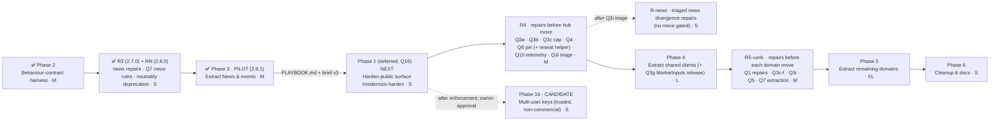

# Modernization Brief — yahoo-finance-mcp

**Status: v3 APPROVED 2026-10-16 for Phase 1, R4 and Phase 4 (§8).** v2 was approved 2026-10-15 for Phase 2, R3, RN and Phase 3; all four are done and live-verified. This document is the executable plan. The execution commands read it, and they treat each phase's scope, entry criteria and exit criteria as binding gates. **To steer execution, edit this file.** An edited entry criterion is honoured; a note in chat is not.

v2 (2026-10-15) folds in the owner's answers to every v1 open question. The source is `OWNER_DECISIONS_20261015.md`; my verification of its claims against the code is summarised in §7.

**v3 (2026-10-16) is the planned post-pilot regeneration.** Nothing in the objective, the target or the owner decisions changes. The changes are:
- **Status:** what has shipped (table below).
- **Lessons:** what the Phase 3 pilot taught (§3 "What the pilot changed").
- **New prerequisites:** source-text test plumbing before Phase 4, and the reseat helper added to R4's Q8 item.
- **Q3i triage:** the ~100 pinned Python/Worker divergences found by the harness feed it.
- **Approval:** a new approval request (§7 A1–A3, §8).

**Done under v2:**

| Item | Release | PR | Live verification |
|---|---|---|---|
| Phase 2 parity harness | tests only | #276 | n/a (CI) |
| R3 news repairs (BR-NWS-007, Q3h) | 2.7.0 | #277 | 6/6 PASS |
| Q7 news rules in the harness, RN neutrality deprecation | 2.8.0 | #278 | 8/8 PASS |
| Phase 3 pilot, news move | 2.8.1 | #279 | 18/18, no structure diff; manifest/schema hashes unchanged |

**Progress as of 2026-10-22.** Releases 2.23.0 to 2.25.7 are merged, deployed and live-verified. Details per finding are in `F_TRIAGE.md` §4 and §5.

| Item | Release | PR | Live verification |
|---|---|---|---|
| R5-extractors (F3, F4, F18; BR-EXT-035, BR-EXT-084) | 2.23.0 | #301 | 2026-10-20 07:45Z, build 2.23.0+git.4cdc53b |
| F21 pinned filing reads | 2.24.0 | #302 | 2026-10-20 08:39Z |
| F19 consensus provenance, F16 estimate rows LOW | 2.25.0 | #303 | 2026-10-20; the baseline for the functional audit |
| Audit repairs F25–F28 | 2.25.1 | #304 | 2026-10-21 01:15Z, build 2.25.1+git.93451d9 |
| F44 docs (Alpha Vantage free-key limit), certifi lock | docs only | #305 | n/a |
| Audit repairs F30, F31, F33, F34, F42 | 2.25.2 | #306 | 2026-10-21 |
| Audit repairs F32, F46 | 2.25.3 | #307 | 2026-10-21 |
| Audit repairs F35–F40, F43 | 2.25.4 | #308 | 2026-10-21 |
| Audit repair F29; Thai fund repairs TF2, TF4, TF5, TF6, TF8 | 2.25.5, 2.25.6 | #309 | 2026-10-21 |
| Thai fund repairs TF3, TF7 | 2.25.7 | #310 | 2026-10-21 |

**Still open:**
- **2.26.0, the Python EDGAR routing release (F7, F1, F2; D9).** It follows Phase 4 unit 1 (EDGAR client move), which is on its branch and merges only after the telemetry baseline gate (first eligible day 2026-10-24).
- **F22, F23, F24:** logged but unclassified. They need an owner decision before anyone builds them.
- **Phase 6 major release (F5, F17, F20, F45, F47):** breaking changes, so a major version. A fresh functional audit runs first (owner, 2026-10-22), to set a new baseline.
- **F41:** deferred (a new capability, P5).
- **TF9 (Thai dividend history empty):** deferred until `SEC_OPEN_DATA_API_KEY` is a cloud environment secret.
- **OPS-TEL-3:** after the Phase 4 exit comparison.
- The low-severity items in `F_TRIAGE.md` §5 are unclassified.

**Universal information outlet (owner direction, 2026-10-15; §7 Q14).** The MCP is a doctrine-neutral information outlet. It publishes facts, provenance and evidence quality in universal language, so any caller can use the data whatever decision framework they follow. It does not carry any one doctrine's vocabulary, permissions or strategy thresholds. Consequences:
- Doctrine-specific fields are replaced with universal equivalents, through a deprecation window (N1–N3).
- The Sniper Doctrine no longer gates this plan. It is one downstream consumer, notified through deprecation notices like any other (N4).
- "Free" means free of doctrine-specific content. **It does not mean unauthenticated**: Q2b auth stands.

| Input | Produced by | Modified (UTC) |
|---|---|---|
| `PREFLIGHT.md` (owner answers, scope boundary) | `/modernize-preflight` | 2026-10-14 11:01 |
| `ASSESSMENT.md`, `ARCHITECTURE.mmd` | `/modernize-assess` | 2026-10-14 11:01 |
| `topology.json`, `call-graph.mmd`, `data-lineage.mmd`, `critical-path.mmd` | `/modernize-map` | 2026-10-14 11:13 (`topology.json` regenerated, identical content) |
| `BUSINESS_RULES.md`, `DATA_OBJECTS.md`, `rules.json` | `/modernize-extract-rules` | 2026-10-14 21:27 (rules.json, verbatim) |
| `OWNER_DECISIONS_20261015.md`, `rule_overrides.json` → regenerated `BUSINESS_RULES.md` | owner, applied 2026-10-15 | 2026-10-15 05:21 |
| `BASELINE.md` (Phase 2 + Q7/RN addendum) | Phase 2 harness | 2026-10-15 18:58 |
| `NEWS_RULES.md`, `news_rules.json` (BR-NWS-101…280) | `/modernize-extract-rules` (Q7, news) | 2026-10-15 16:33 |
| `topology.json` (regenerated after the news move) | `extract_topology.py` | 2026-10-16 02:36 |
| `PLAYBOOK.md`, `PHASE3_SPEC.md`, `PHASE3_IMPORTS_PY.md`, `PHASE3_IMPORTS_TS.md`, `phase3_live_before/after.json` | Phase 3 pilot | 2026-10-16 02:37–03:05 |
| `RN_INVENTORY.md`, `RN_SPEC.md` | RN | 2026-10-15 |
| `DELTA_CATALOG.md` | not required: no language or runtime version changes (§1) | — |

**Binding constraints from PREFLIGHT.md (owner answers, verbatim):**
- Scope: "complete system". The external contract is the public MCP tool surface.
- Builds and tests run locally; CI takes "about 3-4 mins".
- Bespoke build infrastructure: "no".
- Prior attempts: "no".
- The confirmed off-limits list applies to every phase:
  - Lockfiles are regenerated by tools only.
  - The `wrangler.toml` build stamps stay empty.
  - The IR registry is owned by its bot.
  - Frozen public contract: `tool_catalog.json`, `tool_groups.py`, `public_tool_contract.py`, `deployed_canaries.json`, the envelope. Every addition below is a deliberate, versioned contract change.
  - Fixtures are the equivalence oracle.
  - The deploy workflow and version files change only through `release-clerk`.
  - Python and TS always change together.

---

## 1. Objective

Move yahoo-finance-mcp from **two parallel god files** (`server.py`, 12.5k lines; `worker/src/yahoo-finance.ts`, 17.8k lines) to **matching 1:1 domain modules in both runtimes**. The modules sit behind shared, policy-enforcing clients (one EDGAR client, one Yahoo client exposing a normalised `MarketInputs` contract, one allow-listed fetcher, one validation module), with an **execute-both parity harness** proving the two runtimes agree. Python 3.11 and the TypeScript Cloudflare Worker both stay (Q6). The MCP SDK stays on its current major, **2.x** (`mcp` 2.2.0 in `uv.lock`; Q8). This is a **same-stack Refactor plus a governed set of correctness repairs**, not a version uplift.

**Controlling principle (owner decision, verbatim):**
> Pure restructuring preserves behavior. A confirmed Doctrine-critical correctness defect is repaired before, or in the same governed release as, the phase that would otherwise preserve/fossilize it.

*Read under Q14/N4:* "Doctrine-critical" means **data-integrity critical**, as this repository defines it: the P0 class in `BUSINESS_RULES.md`, plus the confirmed semantic/data-integrity defects of Q3i.

**How this brief applies it:**
- Every move PR is byte-identical.
- Every decided repair ships as its **own release, before the phase that moves its domain**, so moves and behaviour changes never share a diff.
- The repair set is Q1's scheduled repairs plus Q2–Q5, Q3a–Q3i and the neutrality changes N1–N3 (§7). It is defined by this repository's data-integrity criteria, not by any consumer's framework (N4).

**Why now:**
- Two High security findings on the public Worker: an open SSRF fetch proxy, and an unauthenticated `/mcp` spending paid quota.
- The god-file tax on every release.
- A parity net that is strong only where code was already extracted.
- 55 code-vs-docs or Python-vs-TS defects found during rule extraction.
- 3–4 minute local CI that makes safe refactoring cheap.

## 2. Target Architecture


| Legacy component | Target component(s) | When |
|---|---|---|
| `worker/src/index.ts`, `mcp.ts` (no auth, unbounded batches, `Access-Control-Allow-Origin: *`) | Edge with an auth abstraction (static bearer), credential-keyed limits and budgets, batch/body caps, unauthenticated no-provider `/health` | Phase 1 |
| `parsePublicTranscript` / `indexEarningsRelease` / `fetchPublicHtml` (TS); `_fetch_public_html` (Py) | `safe-fetch` per runtime: HTTPS only, exact-host allow-list, every redirect re-validated, private/loopback/link-local/IP-literal rejected; `raw_text` never auto-fetches | Phase 1 |
| Default waterfalls that may call paid providers | Paid providers only with auth plus explicit caller opt-in; exhaustion returns a typed non-evidence state (Q2b, name per Q11) | Phase 1 |
| `yfmcp/evidence_store.py` `list()` | Prefix-guarded | Phase 1 |
| Source-text parity assertions; per-module node harnesses | Parity harness, P0 contract suite, pinned divergences | Phase 2 |
| News coverage FULL with failed sources (BR-NWS-007); `sources=[]` substitution drift | Repaired; explicit `sources=[]` = attempt none, with requested/attempted/skipped/defaulted metadata (Q3h) | R3 ✅ 2.7.0 |
| `server.py#news` + `yahoo-finance.ts#news` | `yfmcp/tools/news.py` + `worker/src/news.ts` (**pilot**) | Phase 3 ✅ 2.8.1 |
| Worker ignores `accession_number` | Honoured with Python-equivalent fail-closed semantics (Q3a) | R4 |
| Ticker/accession validation scattered (Worker mostly unvalidated) | One validation module per runtime applied to every relevant action (Q3b) | R4 |
| Worker batch truncation at 5; Python unlimited | Per-tool advertised caps in both runtimes (Q12, Free plan), oversize rejected with `BATCH_LIMIT_EXCEEDED` (Q3c) | R4 |
| `SMOKE_TICKER_CIK_FALLBACKS` in the production lookup (`yahoo-finance.ts:535`, `edgar.py:56`) | Test-only injected fixture (Q4, resolution R1) | R4 |
| No production telemetry | Privacy-minimised Worker telemetry export (Q10) | R4 |
| `mcp[cli]>=1.6.0,<3` with private-internals use | Pinned to `>=2.2,<3`, public APIs only (Q8) | R4 |
| `server.py#shared`, `yahoo-finance.ts#shared`, TS Yahoo client, TS EDGAR client, HTML parsing, ~26 hardcoded URL variants; Python SEC tools using raw `urlopen` | Shared `edgar-client`, `yahoo-client`, `html`, `endpoints` modules per runtime | Phase 4 |
| Valuation inputs from yfinance `.info` (Py) vs raw quoteSummary (TS) | One normalised `MarketInputs` contract owned by the Yahoo client (Q3g) | Phase 4, as its own release after the Yahoo-client move |
| Domain regions left in both god files; `_dispatchTool` switch; inline TS schemas; Python evidence-pack orchestration; `earnings.py` `_server_attr` cycle | Domain modules, table router, `schemas.ts`, `evidence_pack.py`, direct imports | Phase 5 |
| `extract_china_exposure` with hardcoded issuer aliases | Governed preset over `extract_exposure`; aliases in the shared data dir; public action kept (Q5) | R5-extractors, then moved in Phase 5 |
| Python reading `worker/src/*.json` | Shared data dir | Phase 6 |
| `doctrineUse` (ALLOWED / VERIFY_ONLY / DIAGNOSTICS_ONLY / BLOCKED), Worker only; `DoctrineToolStatus` type | Universal `reliabilityClass` (`RELIABLE` / `VERIFY_BEFORE_USE` / `DIAGNOSTIC` / `UNRELIABLE`) in **both** runtimes; old field deprecated, then removed (N1) | RN deprecate (✅ 2.8.0) → Phase 6 remove |
| Always-null boundary fields `g2`, `opportunity`, `action`, `priceTarget`, `scenarioWeights`, `selectedMethod`, `selectedMultiple` | `decisionUse: EVIDENCE_ONLY` as the single universal marker; null fields deprecated, then removed (N2) | RN deprecate (✅ 2.8.0) → Phase 6 remove |
| Strategy labels and thresholds: price-target `bracket` (STRONG_BUY / ACCEPTABLE / CAUTION / AVOID at 75/90/100%), `inferredTag` (SPECULATIVE / LONG / NEAR / INVERTED); liquidity gate (fixed $10M average daily value traded); tier-numbered `t1/t2/t4/t5_inputs` | Raw measures plus neutral, caller-parameterised comparisons: `priceAtOrAboveTarget`; optional caller `min_adv_usd` → `meetsMinimum`; `t1_inputs`/`t2_inputs`/`t4_inputs`/`t5_inputs` → topic-named groups (Q15a). Labels deprecated, then removed (N3) | RN deprecate (✅ 2.8.0) → Phase 6 remove |

## 3. Phased Sequence

**Ordering principle.** Leaf-first by coupling, with the security phase deferred by owner decision (Q16):
1. Build the safety net.
2. Repair what the next move would otherwise fossilise.
3. Prove the move recipe on the least-coupled domain.
4. Secure the public surface (Phase 1, deferred until after the pilot).
5. Extract the shared hub.
6. Extract the remaining domains.
7. Clean up.

**Two kinds of change, never mixed in one PR:**
- **Move PRs** (Phases 3–5): byte-identical output. Harness diff = 0.
- **Repair releases** (stream R): a decided behaviour change. It flips the corresponding pinned divergence in the harness from "expected difference" to the new assertion, ships with its own docs section and version bump, and goes through `CLAUDE.md`'s planner gate for any new field, enum, warning code or `unresolvedReason` (names in §7 Q11).

**Release cadence (Q9):**
- One domain or unit per PR.
- Security, shared-client, SEC, valuation and earnings changes get isolated releases.
- After the pilot, several small, disjoint, byte-identical move PRs may share one deployed release, provided each PR independently shows zero prohibited parity delta and the combined candidate reruns the full acceptance, parity and canary suite.
- Every deployed release gets one version bump, a docs entry, a convergence check and live verification.

**Phase 3 was the pilot, and this brief is still a hypothesis.** The pilot took News & events all the way through and wrote `PLAYBOOK.md`. This v3 is the expected post-pilot revision. **Phase 4's first unit, the EDGAR client, is itself a pilot slice:** expect one more small revision after it.

**What the pilot changed in this plan (v3):**
1. **The move recipe is proven and binding.**
   - Phases 4 and 5 follow `PLAYBOOK.md`.
   - **Scope:** each move's scope is the topology's region list.
   - **Agents:** one agent per runtime in separate worktrees, merged afterwards.
   - **Identity proof:** AST- and text-identity, tool-listing and hash identity, and a harness diff of 0.
   - **Live check:** a structural before/after comparison on the deployed Worker.
2. **Source-text tests are the main friction.** Fourteen test scripts read god-file text and had to be retargeted. A tests-only cleanup (read all domain modules through one helper, or switch to behavioural checks) is now a **Phase 4 entry criterion**. Without it, every hub move pays the same tax.
3. **Patch targets silently follow moved code.** A case that patches `server.X` stops affecting moved code. The harness refuses network access, so a miss fails loudly instead of calling live services. Keep that guard. The playbook requires retargeting patches as part of each move.
4. **A new private-internals use exists.** `reseat_tool_registration` (`yfmcp/app.py`) keeps the tools/list order by reordering FastMCP's `_tool_manager._tools`, and fails loudly if the internals change. **R4's Q8 item now covers replacing it** with a public registration-order API, or with registering in order.
5. **Phase 4 inputs are now concrete.** `PHASE3_IMPORTS_TS.md` lists the 23 helpers `news.ts` imports from `yahoo-finance.ts`:
   - provider fetch, cache and timeout;
   - the Yahoo `yGet` family;
   - EDGAR HTML, submissions and CIK;
   - `_str`, `clampInt`, identity and FX helpers;
   - `resolveEx991Url`.

   These are the Worker hub candidates. `resolveNewsCompanyIdentity` and `finnhubEligibility` are news-specific but still sit in `#shared`. Python's news module already imports only from `yfmcp.*`.
6. **The harness found about 100 Python/Worker divergences that no decision covers.** They are pinned as `FINDING` cases: 90 in news, about 10 in pricing, valuation and SEC/earnings (`BASELINE.md`). They don't block moves, which preserve them, but **Q3i triage now has a concrete list**. R4 includes the triage. News repairs no longer gate any move, because news has already moved. They ship as their own release ("R-news") once triaged.
7. **Release overhead.** A pure move costs about the same release overhead as a behaviour release: version bump, docs, CI, PR and live verification. The Q9 batching rule (several small disjoint moves per release) should be used in Phase 5.
8. **The harness stays fast.** It holds 1072 cases (1078 tests) and runs in about 28 s, well under the 2-minute budget.



**Execution order (Q16): Phase 2 ✅ → R3 + RN ✅ → Phase 3 (pilot) ✅ → Phase 1 → R4 → Phase 4 → R5 → Phase 5 → Phase 6.** R-news follows the R4 triage and gates nothing. Phase 1b (candidate) can follow Phase 1's enforcement release and gates nothing either. Phase numbers are kept as identifiers. Sizes are relative shares of the production-code COCOMO-II index (≈ 261 over 59.1 KSLOC, from `ASSESSMENT.md`). **They rank phases against each other and are not durations.**

Every PR follows `CLAUDE.md`: the TS change first, then the `python-mirror` port, then parity tests, then a section in `docs/provider-runtime-guidance.md`, then `release-clerk`, then `live-verifier` after deploy.

### Phase 1 — Harden the public surface ✅ (complete 2026-10-16: releases 2.9.0–2.11.0)
- **Command:** `/modernize-harden yahoo-finance-mcp`.
- **Scope:**
  - **Q2a:** strict HTTPS allow-list. SEC Archives and approved SEC endpoints, the exact Yahoo hosts needed by the transcript and news workflows, and the exact hosts of IR-registry entries with status `approved`. Every redirect hop is re-validated. Private, loopback, link-local and IP-literal destinations are rejected. No wildcards. `raw_text` is caller content only and never auto-fetches. This also covers the earnings-release URL policy (BR-ERN-017).
  - **Q2b + Q13:** `/mcp` requires the static credential behind a replaceable auth abstraction, supplied as `Authorization: Bearer <token>` or the secret path `/mcp/<token>`. The path segment is redacted from every log, export and error. The claude.ai connector is re-added with the secret-path URL in the same release window. Rate limits and provider budgets are keyed by credential, not IP. An unauthenticated `/health` may exist only if it makes no provider calls. Paid providers need auth **and** explicit caller opt-in, and default waterfalls never force them. Budget exhaustion returns a typed non-evidence state, never `NOT_FOUND`.
  - **S-03:** JSON-RPC batch cap of **1 tool call per HTTP request** (Q12) and a body cap.
  - **News budget follow-through (moved from R3, Q16):** sources starved by the subrequest budget are reported `PROVIDER_BUDGET_EXHAUSTED` and coverage states the budget cause (today's live MSFT 0-item case).
  - **Per-invocation subrequest budget guard (V3, required on any plan):** count `fetch()` and Cache API calls in the request scope against the **50-per-invocation Free limit** (leave a reserve for the response path), stop starting new upstream work before the limit, and mark the affected sources `PROVIDER_BUDGET_EXHAUSTED`, never `PROVIDER_ERROR` or clean absence. Production already exceeds Free's 50 (V3).
  - **Paid-provider scope (owner decision 2026-10-16):** Finnhub, Alpha Vantage and Marketaux are quota-limited free tiers, not paid providers, so they stay in the defaults. `PROVIDER_OPT_IN_REQUIRED` is reserved for a provider the owner pays for later. Release 3c carries the budget guard only (`PHASE1_R3C_SPEC.md`).
  - **S-05:** evidence-store `list()` guard.
  - **S-07/S-09:** workflow permissions, `--ignore-scripts`, actions pinned to SHAs.
  - **S-10/S-11:** dependency upgrades, `uv sync --frozen`, audit gates.
  - **S-13:** restrict CORS once auth exists.
- **Entry criteria:**
  - [x] Phase 3 exit criteria are met (Q16: Phase 1 runs after the pilot). *(2.8.1 live-verified 2026-10-16; brief v3 is the last exit item and is approved with §8.)*
  - [x] The owner has created the `MCP_TOKEN` Worker secret (at least 32 random bytes, URL-safe) and the matching GitHub Actions secret, and is ready to re-add the claude.ai connector with the `/mcp/<token>` URL in the release window (§7 A1). *(Done 2026-10-16; the connector reports `credentialTransport: "path"`.)*
  - [x] Phase 2 harness cases that touch `/mcp` transport, canaries or the two fetching tools are updated in the same release, because they characterised the unauthenticated behaviour.
  - [x] §7 Q12 decided 2026-10-15: stay on Free; per-tool caps; JSON-RPC batch = 1 tool call.
  - [x] §7 V1 / Q13 resolved 2026-10-15: no Request headers in claude.ai, so the credential is accepted as a bearer header **or** the secret path `/mcp/<token>`.
  - [x] Scripts send `Authorization` from an `MCP_TOKEN` secret (all 9 scripts that post to `MCP_URL`). *(2.9.0; the ci.yml alias step gained the secret in 2.9.1.)*
  - [x] §7 Q11 names confirmed (2026-10-15): `AUTH_REQUIRED`, `BATCH_LIMIT_EXCEEDED`, `PROVIDER_BUDGET_EXHAUSTED`, `PROVIDER_OPT_IN_REQUIRED`.
  - [x] The owner acknowledges §7 V2: with **0 approved IR entries** today, company-IR URL fetches are refused until entries are approved. *(Acknowledged 2026-10-16.)*
  - [x] `main` CI is green. *(Every Phase 1 PR (#280–#284) merged green, including the new Dependency audit job.)*
  - [x] S-01 and S-02 are covered by tests. *(S-01 SSRF and its Python mirror S-04: `scripts/test_url_policy.py` and parity `ptr.url.*`. S-02 unauthenticated `/mcp`: `scripts/test_worker_auth.py`. S-02 is Worker-only, because the Python server is stdio. The tests were written alongside the fixes, not as failing tests first.)*
- **Exit criteria:**
  - [x] SSRF tests pass in both runtimes (http redirect, non-allow-listed host, loopback, link-local, IP literal, `raw_text` containing a URL is not fetched). *(2.10.0, #283; `scripts/test_url_policy.py` in both runtimes. Live-verified 2026-10-16 09:02Z: `example.com` and `169.254.169.254` refused, `raw_text` with a URL not fetched, SEC/Yahoo paths intact, CORS restricted. Deploy run #262 green on re-run: the first attempt's blocking failure was a Thai SEC Open Data upstream timeout that passed on the candidate 30 s earlier.)*
  - [x] Unauthenticated `/mcp` is rejected with the confirmed code. Authenticated canaries pass. `/health` makes zero provider calls (asserted). *(2.9.1 live 2026-10-16 07:10Z: no credential and a wrong path token both return 401 `AUTH_REQUIRED`; `/health` 200; deploy run #260 canaries green; zero-fetch `/health` asserted in `test_worker_auth.py`.)*
  - [x] Anonymous or no-opt-in calls make zero paid-provider requests (asserted with a fetch spy). Exhaustion returns the typed state. *(Anonymous `/mcp` calls are refused before any fetch (2.9.1). Opt-in is not applicable: the owner decided on 2026-10-16 that Finnhub, Alpha Vantage and Marketaux are free tiers. Exhaustion returns `PROVIDER_BUDGET_EXHAUSTED` (2.11.0, #284), covered by `test_worker_budget.py`, `test_python_budget.py` and parity `budget.*`.)*
  - [x] Audits are clean or have documented exceptions. The acceptance suite is green. The live verifier confirms. *(pip-audit and npm audit report 0 (3a, #282). Live-verified: 2.9.1 enforcement, 2.10.0 allow-list and CORS, and 2.11.0, served at 15:24Z with deploy run #263 green and default MSFT news unchanged. A live call over the budget could not be produced through grouped mode, so the guard's refusal path rests on the offline tests.)*
- **Relative size: S.**
- **Risk: Medium.**
  - Risk 1: auth locks out a client that can't send headers. *Mitigation:* V1 gate, plus a token-issued grace release before enforcement.
  - Risk 2: the allow-list blocks legitimate URLs (the IR registry is empty). *Mitigation:* `raw_text` escape hatch, plus approving registry entries through the existing bot and review flow.

### Phase 1b — Multi-user access for trusted, non-commercial sharing (APPROVED 2026-10-18; PARKED 2026-10-19)
- **Parked (owner, 2026-10-19):** "Park phase 1b and proceed to later phase".
  - **State:** all 1b code shipped inactive in 2.18.0 (#295). Only the owner key works.
  - **To resume:**
    1. The owner creates the KV namespace `yfmcp_access_keys` and gives its ID.
    2. The activation PR adds the KV binding, the `USAGE` Durable Object binding and the `new_sqlite_classes` migration, plus the dispatch-only `apply-do-migration.yml` (`PHASE1B_SPEC.md` §9).
  - Parking gates nothing, because 1b never gated another phase.
- **Approval (owner, 2026-10-18):** "1b approved". The names were accepted as proposed:
  - **KV namespace:** `yfmcp_access_keys`, binding `ACCESS_KEYS`.
  - **Key record:** stored under the key's SHA-256 hash, with the fields `id` (an 8-character hash prefix), `label`, `createdAt`, `status` (active or revoked), `dailyLimit`, `perMinuteLimit` and `paidProviders`.
  - **Admin script:** `scripts/manage_access_keys.py` with `issue`, `list`, `revoke` and `set-limits`.
  - **`health_check`:** shows no label.
  - **Errors:** the new error code `KEY_RATE_LIMITED` for a key over its limits. A revoked or unknown key gets the existing `AUTH_REQUIRED`.
  - **Owner key:** `MCP_TOKEN` stays the owner key.
  - **Constraints accepted:** about 100,000 requests per day are shared across all users, and the data is for non-commercial, personal use only.
  - **Scheduling:** it ships after R4 (2.15.0), alongside R-news. It gates nothing.
- **Purpose:** the owner wants to share the hosted MCP with a few trusted people, non-commercially. Phase 1's single shared `MCP_TOKEN` can't tell callers apart, can't cut off one person, and puts everyone on one quota.
- **Command:** `/modernize-harden yahoo-finance-mcp`, as a follow-on release to Phase 1. Worker only: the local Python server is stdio and single-user.
- **Scope:**
  - **Per-user keys behind the existing auth abstraction** (`worker/src/auth.ts`, Q2b). The same transports apply: `Authorization: Bearer <key>` or `/mcp/<key>`.
  - **Key storage:** keys live in a Cloudflare KV namespace (Free plan), stored **hashed** (SHA-256), never in plain text. Each record holds a non-secret label (for example a first name), a created date, a status (active or revoked) and per-key limits.
  - **The owner's existing `MCP_TOKEN` keeps working** as the owner key.
  - **Per-key limits:**
    - a daily request cap and a per-minute rate limit;
    - paid-provider calls allowed only for keys the owner enables (extends Phase 1's opt-in rule);
    - the per-request subrequest budget guard applies to every key.
  - **Revocation:** revoke one key without affecting the others.
  - **Admin:** a small owner-only script (`scripts/manage_access_keys.py`, using `wrangler kv`) to issue, list (labels only), revoke and set limits. No admin HTTP endpoint, so there is no new attack surface. A newly issued key is shown once, to the owner only.
  - **Telemetry (Q10):** records a short **key id** (a prefix of the hash), never the key or the label, so usage per person is visible without exposing secrets.
  - **`health_check`:** may report the calling key's label, or nothing. Decide with the names below.
- **Not in scope:** commercial use, billing and metering, OAuth sign-in, self-service sign-up. Commercial use additionally needs licensed market data, because Yahoo's terms generally prohibit redistribution and the key-gated providers' free tiers are non-commercial, plus the Workers Paid plan (reopens Q12).
- **Entry criteria:**
  - [ ] Phase 1 enforcement release is live and verified.
  - [x] The owner approves this phase and the new names (KV namespace, key record fields, the `scripts/manage_access_keys.py` commands, any new `health_check` field and any new error code such as a per-key rate-limit code), per the Q11 process.
  - [x] The owner accepts the sharing constraints: about 100,000 requests per day are **shared across all users** on the Free plan (Q12), and the data stays **non-commercial and personal-use only** under the upstream providers' terms. Each person is told this.
- **Exit criteria:**
  - [ ] Per-key auth, revocation and limits are tested in the Worker test suite: valid, revoked, unknown, over-limit, owner key.
  - [ ] No key or label appears in any response, log, error or telemetry. Telemetry shows the key id only.
  - [ ] Revoking one key leaves the others working (live-verified with two test keys).
  - [ ] The docs explain how to issue, rotate and revoke keys and what each user must not do (no redistribution).
- **Relative size: S.**
- **Risk: Medium.**
  - Risk 1: one heavy user exhausts the shared Free daily cap for everyone. *Mitigation:* per-key daily caps summing below the plan cap, plus telemetry alerts.
  - Risk 2: a shared URL with an embedded key leaks. *Mitigation:* per-person keys, revoke-and-reissue, and the path segment redacted everywhere (Phase 1).

### Phase 2 — Behaviour-contract harness (characterisation)
- **Command:** `/modernize-transform yahoo-finance-mcp`, characterisation step only.
- **Scope:**
  - One parity harness that drives both runtimes from the same fixtures for every P0 rule in §5 (about 45 distinct behaviours).
  - Every decided-repair item (35 rules tagged in `BUSINESS_RULES.md` §3, plus Q3a/Q3h/Q4 behaviours) is pinned as **current** behaviour, with an assertion tagged by its decision ID. The repair release flips it later.
  - Record `BASELINE.md`.
- **Entry criteria:**
  - [x] `BUSINESS_RULES.md` has the 6 P0 cards corrected per Q1 (done 2026-10-15; all 84 P0 cards are now High confidence).
  - [x] Node is available in CI (it is).
- **Exit criteria:**
  - [x] Every P0 ID maps to at least one execute-both case; the table is in `BASELINE.md`. *(Met 2026-10-15, #276: 84/84.)*
  - [x] Every repair-scheduled item has a pinned current-behaviour assertion carrying its decision ID. *(39/39.)*
  - [x] The harness adds less than 2 minutes to CI. *(About 15 s.)*
  - [x] `BASELINE.md` is committed.
- **Relative size: M.**
- **Risk: Low.**
  - Risk 1: buried TS functions are hard to call. *Mitigation:* the esbuild bundle-and-call pattern, or testing at the tool boundary.
  - Risk 2: duplicate P0 cards inflate the suite. *Mitigation:* one case per behaviour, tagged with all matching IDs.

### Stream R — Correctness repair releases
Each R-release is a set of **separately released** behaviour changes that must be live before the move it precedes. All follow the TS → Python mirror → parity flip → docs → version bump → live-verify order.

- **RN: neutrality deprecation release (Q14, N1–N3); ships with or right after R3, before Phase 3.** One cross-cutting release in both runtimes:
  - *Status 2026-10-16: released as 2.8.0 (#278) and live-verified 8/8 on build 2.8.0+git.13119f9. Wording notes for the Phase 6 removal release: the price-target notice names `referenceTargetPct` as a replacement although it is a ratio, not a direction; the deprecated `tagNote` still says "Use inferredTag", which is itself deprecated.*
  - **Add the universal fields:** `reliabilityClass` on every tool status (Python gains it too, which also closes the Worker-only parity gap), `priceAtOrAboveTarget`, the optional `min_adv_usd` input with `meetsMinimum`, and the four topic-named input groups (Q15a).
  - **Keep the old fields for the window:** `doctrineUse`, the seven null boundary fields, `bracket`, `inferredTag`, the fixed liquidity-gate fields and the four `t*_inputs` groups are still emitted with **identical values**, marked deprecated in the schema descriptions and `docs/provider-runtime-guidance.md`, with a `DEPRECATED_FIELD` notice naming each field's replacement.
  - **Window:** at least **one minor version**. The removal release is in Phase 6.
  - **Release mechanics:** additive, so a minor version bump. Frozen-contract tests and canaries are updated in the same release. The harness pins both old and new fields.
- **R3 (before Phase 3):**
  - BR-NWS-007: news coverage must not report `FULL` while required sources have failed (Q3i).
  - *(V3 news budget follow-through moved to Phase 1 with the budget guard it depends on; Q16.)*
  - Q3h: `sources` omitted or null means the defaults; `sources=[]` means attempt none; requested, attempted, skipped and defaulted metadata kept separate; `sourceStatus` describes what actually happened.
  - **Q7:** targeted rule extraction for News (`/modernize-extract-rules` with a news `modulePattern`), with the new rules folded into Phase 2's harness.
- **R4 (before Phase 4):**
  - *Status 2026-10-17:*
    - **Q10 telemetry (2.11.1, #285):** merged. Its first deploy failed at upload because Analytics Engine was not enabled on the account (code 10089). The owner enabled it and created the `yfmcp_telemetry` dataset; the enable took effect only after a delay of several hours.
    - **Q3b and Q3c (2.12.0, #286):** merged and deployed together with 2.11.1 (run #265, attempt 5, canaries green).
    - **Live-verified 2026-10-17 18:08Z:**
      - 10 quotes are served;
      - 11 tickers get `BATCH_LIMIT_EXCEEDED`;
      - `get_company_news` with 2 tickers and `company_ir` gets `BATCH_LIMIT_EXCEEDED` (cap 1);
      - ticker `BRK/B` gets `INPUT_VALIDATION_ERROR` before any fetch;
      - `health_check` reports 2.12.0.
    - **Telemetry export:** the `CLOUDFLARE_TELEMETRY_TOKEN` secret was added. The first manual export (run 39057113176) authenticated against both Cloudflare APIs. It recorded 0 requests, because its window ended at 18:00Z, before the deploy.
    - **Q3a and Q4 (2.13.0, #287):** merged, deployed (run #266, canaries green) and live-verified 2026-10-17 19:15Z:
      - a fake accession `0000320193-99-999999` gets `ACCESSION_NOT_FOUND`;
      - `get_sec_filing_outline` with only a real AAPL accession returns that filing's outline;
      - `list_sec_company_filings` still resolves CIKs without the smoke table.
    - **Q8 (2.13.1, #288):** merged, deployed (run #267, canaries green) and live-verified 2026-10-17 19:29Z. `health_check` reports 2.13.1, and `manifestHash`/`schemaHash` are identical to 2.13.0. Python `tools/list` is byte-identical before and after.
    - **Telemetry export:** confirmed working end to end.
      - The first export with data was manual run 39061323142 (68 requests).
      - 2.13.1 fixed the Workers Logs query, which had read 0 invocations. Run 39062644642 read 45 invocations by action: 42 `ok`, 3 `unknown`.
      - `$workers.scriptName` is confirmed. The outcome comes from the invocation event joined on `$metadata.requestId`.
      - **The 7-day Phase 4 baseline counts from 2026-10-17**, the first export with data; the first eligible day is 2026-10-24.
    - **Q3i triage: APPROVED 2026-10-18** (`Q3I_TRIAGE.md`; owner: "agree, add it to R-news and approve Q3i triage").
      - 152 rows: 80 repair, 28 preserve align-free, 14 preserve document, 30 planner calls (decided in §2 of that file).
      - Releases: R4b before Phase 4; R-news (provider adapters, then the source registry and the `NEWS_SOURCES_DISABLED` off switch, then the news repairs); R5-shared (the BR-ENV-001 confidence default); and R5-‹unit›.
    - **R4b-1 (2.14.0, #289) and R4b-2 (2.15.0, #290):** merged, deployed (runs #268 and the 2.15.0 deploy, canaries green) and live-verified on 2026-10-18.
    - **R4 is complete as of 2026-10-18.**
    - **2026-10-19:**
      - R-news part 3 is complete: Batch C in 2.20.0 (#297), plus the F15 patch 2.20.1 (#298).
      - **R5-shared (BR-ENV-001) is released as 2.21.0 (#299) and live-verified.**
      - Phase 4 unit 1 (EDGAR client move, both runtimes) is on the branch, unmerged until the telemetry baseline gate (2026-10-24).
    - **2026-10-20 to 2026-10-21:** 2.23.0 to 2.25.7 shipped and were live-verified (table at the top). The Python EDGAR routing release (F7, F1, F2) is now numbered 2.26.0 and follows Phase 4 unit 1.
  - Q3a: the Worker honours exact `accession_number` with fail-closed semantics.
  - Q3b: central ticker and accession validation in both runtimes, on every relevant action, including the Python paths that skip it.
  - Q3c + Q12: the per-tool ticker caps from the §7 Q12 table, advertised as schema `maxItems` and rejected with `BATCH_LIMIT_EXCEEDED` in both runtimes. Measure `get_market_snapshot` first and set its cap. Correct the stale comment at `yahoo-finance.ts:58–64`.
  - Q4: smoke-ticker table out of the production lookup.
  - Q8: pin `mcp>=2.2,<3` and replace private-internals use with public APIs, failing loudly. That covers `_tool_manager._tools`, the `FastMCP.tool` monkey-patch and, new in v3, `reseat_tool_registration` from the news move.
  - Q10: privacy-minimised telemetry export capturing a **baseline window before any Phase 4 merge**.
  - Q3i items in the SEC and shared domains (3 tagged in §3).
  - **R4 triage input (added 2026-10-16, from the 2.10.0 deploy):** `extract_sec_filing_fact` on the PARSED_TABLE path returns `evidence: null` because `worker/src/response.ts` drops evidence rows that have no url or row fields. The content survives only as `sourceEvidence`. 2.9.1 behaves identically (checked side by side against live SEC). The advisory `test_deployed_discovery.py` AAOI check fails or passes depending on data and cache state. Classify as repair (map table evidence into the standardised row) or preserve (relax the smoke check).
  - Q3i triage, classified repair or preserve, with the result written into §7. It covers the remaining 20 untagged defects plus the pinned `FINDING` divergences from `BASELINE.md` (about 100; 90 in news). The planner drafts one classification table for one owner approval (§7 A2). Triage inputs from live verification:
    - `get_company_news` reports coverage `FULL` while a source is truncated;
    - `tool_catalog.json` omits `sources` for `get_company_press_releases`;
    - two RN deprecation wording notes (see RN status).
  - **Triage inputs added 2026-10-17 (from 2.12.0 to 2.13.1):**
    - **Ticker grammar:** real Yahoo symbols containing `&` (e.g. `M&M.NS`) are rejected in both runtimes. Admitting them needs an audit that every URL build encodes `&`.
    - **Accession readers:** `extract_geographic_revenue`, `query_sec_filing_index` and the exhibit tools use an accession without the Q3a existence check. Both runtimes behave the same.
    - **Outline shape:** `get_sec_filing_outline` output still diverges; `OUTLINE_NOT_PARSED` and `tableCount` exist in the Worker only.
    - **Python `outputSchema`:** the Python listing carries the SDK's auto-derived output schema, not the declared one. The 97 declarations were silently dropped on SDK 2.x and were removed in 2.13.1.
    - **Telemetry follow-ups:**
      - The Worker could log the dispatch line as an object rather than a JSON string, so it is field-indexed. This is a Worker change.
      - A coverage guard could flag when Analytics Engine counts requests but Workers Logs counts 0.
      - `wrangler.toml` sets `[observability] enabled = false` alongside `[observability.logs] enabled = true`.
      - Logged invocations (45) are fewer than Analytics Engine requests (68), and 3 outcomes are `unknown`.
- **R-news default sources (owner, 2026-10-18):** `sec` joins the default sources of `get_company_news`, next to Yahoo news, Yahoo press releases, Finnhub and Marketaux. It ships in R-news after the source registry.
- **R-news (after the R4 triage; gates no move):** the news divergences triaged as "repair" ship as one release, each flipping its pinned case to equal.
- **Phase 4 inner release:** Q3g, the `MarketInputs` contract. It ships right after the Yahoo-client move PR and before any valuation work.
- **R5-‹unit› (before each Phase 5 unit), the repairs tagged for that unit's domain in `BUSINESS_RULES.md` §3:**
  - **Pricing/options:** BR-PRC-002 exchange-session-aware freshness (adds a shared exchange-holiday calendar data file; V5), Q3c zero volume (ratio null, flag null/UNKNOWN, explicit warning), Q3d raw-ratio thresholds with deterministic display rounding and no synthesised `dataDate`, short-history CAGR.
  - **Fundamentals:** incomplete-TTM state, the negative-earnings-base credit state, newest-first beat streak.
  - **Extractors:** BR-EXT-015 monetary loss sign, Q3f inclusive `>=` (§7 V4), Feb 29 arithmetic, `NT$`/`A$` currency recognition, and Q5 China preset with aliases moved to data.
  - **Valuation:** BR-VAL-006 debt-group completeness, BR-VAL-025 unresolved parent income, Q3e tolerance NaN/inf handling and the AGREED wording, EV convertible-debt basis.
  - **Earnings:** transcript fallback ordering by sources actually attempted, surprise actuals per the source policy (resolution R3: official release first).
  - **Providers:** eligibility policy fails closed.
  - **Shared (Form 4):** multi-line parsing.
  - **Fundamentals and providers** each get a **Q7** targeted rule extraction before their R5 release.
- **2.25.0 functional audit (2026-10-20):** 23 new findings, F25–F47, are classified in `F_TRIAGE.md` §5. F25–F28 ship as the 2.25.1 repair patch; the rest join the R5 releases above or Phase 6, pending owner approval.
  - *Status 2026-10-22:* the owner approved F29–F47 as recommended on 2026-10-21. 2.25.1 to 2.25.5 (#304, #306–#309) closed F25–F40, F42, F43 and F46, and F44 closed by docs (#305). All are live-verified. F41 is deferred; F45 and F47 wait for Phase 6. The Thai fund audit (2026-10-21) shipped as 2.25.6 and 2.25.7 (#309, #310); TF9 waits on the SEC Open Data API key.
- **Entry criteria (each R-release):**
  - [ ] Its pinned assertions exist (Phase 2).
  - [x] Any new name it introduces is confirmed in §7 Q11 (all accepted 2026-10-15; a name not in that table needs a new owner decision).
- **Exit criteria (each R-release):**
  - [ ] Its pinned assertions are flipped and pass in both runtimes.
  - [ ] The rest of the harness diff is 0.
  - [ ] The acceptance suite and canaries are green.
  - [ ] The docs section is merged and the live verifier confirms.
- **Relative size: M in total**, spread across the stream.
- **Risk: Medium.**
  - Risk 1: a repair silently changes output that downstream callers or the Doctrine rely on. *Mitigation:* isolated releases, documented field-level diffs, owner UAT.
  - Risk 2: repairs drift between runtimes. *Mitigation:* each repair flips an execute-both assertion, so both runtimes must change together.

### Phase 3 — PILOT: extract News & public events
- **Command:** `/modernize-transform yahoo-finance-mcp`, unit: News & public events.
- **Scope:**
  - Move the `server.py#news` and `yahoo-finance.ts#news` functions into `yfmcp/tools/news.py` and `worker/src/news.ts`. *(Path amended 2026-10-16 to follow the repo's `yfmcp/tools/<domain>.py` precedent from the pricing and earnings moves; implementation spec: `PHASE3_SPEC.md`.)*
  - The tools are `get_company_news`, `search_company_news`, `get_company_press_releases`, `get_public_event_timeline`, `get_sec_recent_events` and `verify_company_event`. `get_uk_company_filings` moves with providers.
  - Output must be byte-identical. Imports back into the god files are allowed and recorded.
- **Entry criteria:**
  - [x] Phase 2 exit criteria are met. (Phase 1 is no longer a prerequisite: Q16.) *(#276 merged 2026-10-15.)*
  - [x] R3 is released and live-verified. *(2.7.0, #277; live verifier 6/6 PASS on build 2.7.0+git.e420803, 2026-10-15.)*
  - [x] The Q7 news rules are in the harness. *(BR-NWS-101..280: 282 cases, 180/180 rules covered; merged in #278.)*
- **Exit criteria:**
  - [x] The topology re-run shows 0 NLOC in both `#news` regions. *(2.8.1, #279.)*
  - [x] Harness diff = 0; acceptance suite and canaries green; the live verifier compares structure and coverage before and after. *(1078 OK with no expected value changed; live 18/18 no structure diff, manifest/schema hashes unchanged: `phase3_live_before.json` vs `phase3_live_after.json`.)*
  - [x] `PLAYBOOK.md` is written.
  - [ ] This brief is regenerated and re-approved for R4 and Phase 4.
- **Relative size: M** (about 6.1 KSLOC, about 10%).
- **Risk: Medium.**
  - Risk 1: hidden coupling to the shared helpers. *Mitigation:* allow imports back, list them for Phase 4.
  - Risk 2: per-release overhead. *Mitigation:* the pilot measures it, and the Q9 batching rules apply after the pilot.

### Phase 4 — Extract the shared clients (the hub)
- **Command:** `/modernize-transform yahoo-finance-mcp`, units in order:
  1. EDGAR client (this phase's own pilot slice).
  2. Yahoo client.
  3. HTML/table parsing.
  4. Endpoint builder.

  The Q3g `MarketInputs` release ships between units 2 and 3.
- **Scope:**
  - Move the shared regions and the inline TS Yahoo/EDGAR clients and parsing into client modules. The 23 helpers listed in `PHASE3_IMPORTS_TS.md` are in scope, and `news.ts` must import them from the client modules afterwards, not from `yahoo-finance.ts`.
  - Route the Python SEC filing tools through `yfmcp/clients/edgar.py`. This changes the User-Agent and adds caching; Q3a in R4 already aligned the accession semantics.
- **Entry criteria:**
  - [x] Phase 3 exit criteria are met; `PLAYBOOK.md` is written. *(The regenerated brief is approved with §8.)*
  - [x] Phase 1 is released and live-verified.
  - [x] **Source-text test cleanup is merged** (pilot lesson 2): no test reads `server.py` or `yahoo-finance.ts` text directly; they read through one helper that covers all domain modules, or check behaviour.
  - [x] Each hub unit's spec lists its scope from the topology (`#shared` plus the client functions), as in `phase3_news_region.json`. *(`PHASE4_SPEC.md` and `phase4_*_region.json`, 2026-10-19. Planner decisions in §11a. They add a fifth "shared utilities" unit, and a topology override that assigns cross-called tool handlers to their catalog domain, so `#shared` means hub code only.)*
  - [x] R4 is released (2.11.1–2.15.0, complete 2026-10-18).
  - [ ] **The telemetry baseline window is captured** (Q10). It runs from 2026-10-17, and the first eligible day is 2026-10-24. Exclude the preview-canary requests (Q3i finding F6).
- **Exit criteria:**
  - [ ] No `#shared` region remains.
  - [ ] Zero SEC fetches happen outside the client in either runtime (grep).
  - [ ] Q3g is released: both runtimes consume `MarketInputs`, and the unused helper is removed or repurposed only after fixtures prove the replacement.
  - [ ] Harness, acceptance and canaries are green.
  - [ ] Latency and error rates compared against the baseline show no regression beyond agreed bounds.
- **Relative size: L.**
- **Risk: High.**
  - Risk 1: the highest fan-in, so a subtle client change breaks distant tools. *Mitigation:* full harness after each unit, one client per PR.
  - Risk 2: Yahoo crumb and throttling regress. *Mitigation:* cache and throttling suites, telemetry comparison, live verifier.

### Phase 5 — Extract the remaining domains
- **Command:** `/modernize-transform yahoo-finance-mcp`, one unit per domain, following `PLAYBOOK.md`.
- **Scope, in order, each unit preceded by its R5 release:**
  1. SEC retrieval.
  2. Extractors/exposure.
  3. Pricing/options.
  4. Fundamentals/analyst.
  5. Providers, including Companies House.
  6. Earnings: remove the `_server_attr` cycle.
  7. Python evidence-pack orchestration.
  8. Table router and `schemas.ts`.
- **Entry criteria, per unit:**
  - [ ] Its R5 release is live.
  - [ ] Its P0 IDs are covered (Phase 2).
  - [ ] For fundamentals and providers, the Q7 extraction is folded in.
- **Exit criteria, per unit:** region gone (topology); harness diff = 0; acceptance and canaries green.
- **Exit criteria, for the phase:**
  - [ ] `server.py` has fewer than 1,000 lines.
  - [ ] `yahoo-finance.ts` is removed or under 500 lines.
  - [ ] The switch is replaced by a table.
  - [ ] No function has CCN ≥ 100 (lizard).
- **Relative size: XL** (holds 75 of the 84 P0 rules).
- **Risk: High.**
  - Risk 1: P0 logic shifts during the move. *Mitigation:* moves only, harness diff = 0 per P0 ID.
  - Risk 2: runtime drift mid-phase. *Mitigation:* the `CLAUDE.md` order inside one PR.

### Phase 6 — Cleanup and documentation
- **Command:** `/modernize-transform yahoo-finance-mcp`; `release-clerk`.
- **Scope:**
  - Shared data dir (Python stops reading `worker/src`).
  - Deprecated stdlib calls (Debt #9).
  - Swallowed-error audit (Debt #5; new warning codes via Q11).
  - Stale comments and the "79 tools" text (Debt #10).
  - `docs/architecture.md` with the module map.
  - Q3i items triaged as "preserve" get documented as intentional.
  - **Neutrality removal release (N1–N3):** after at least one minor version since RN, remove `doctrineUse`, the seven null boundary fields, `bracket`, `inferredTag`, the fixed liquidity-gate fields and the four `t*_inputs` groups from both runtimes. This is a breaking public-contract change, so it needs a **major version bump** under the README's semver policy (or the owner records an exception). Rename the internal `DoctrineToolStatus` type and `TOOL_DOCTRINE_STATUS` table to neutral names.
  - **Neutrality audit:** every label-producing field in the contract must be either a factual classification or derived from documented thresholds the caller can override. Doctrine or strategy vocabulary stays out of names, enums and descriptions (extends `docs/tool-naming.md`). Generic market terms (bullish/bearish, credit tiers) are reviewed against that rule.
  - **Triaged findings for the major release:** F5 and F45 (retire `meta.decisionGrade`), F17 (Python holder row shape), F20 (status strings out of `confidence`), F47 (Python events calendar keys). Each gets its deprecation notice first, per `F_TRIAGE.md`. *Status 2026-10-28: the notices, with the F61 aliases (`ivPctile`, `putVolVs10dAvg`, the rating-change `*30d` keys), F59 (earnings envelope shape) and F60 part 3 (one period vocabulary), ship in 2.27.0; see `docs/provider-runtime-guidance.md` "Phase 6 Deprecation Notices (2.27.0)".*
- **Entry criteria:**
  - [ ] Phase 5 exit criteria are met.
  - [ ] A fresh functional audit of the deployed release is done, so the breaking changes start from a current baseline (owner, 2026-10-22).
- **Exit criteria:**
  - [ ] Python reads nothing under `worker/src`.
  - [ ] `docs/architecture.md` is merged.
  - [ ] Neutrality: a repo-wide check (CI test) finds no `doctrine` term in any public schema, field, enum or description, and the deprecated fields are gone.
  - [ ] No pinned "expected difference" remains in the harness except documented intentional ones.
  - [ ] Acceptance suite, canaries and live verification are green.
- **Relative size: S.**
- **Risk: Low–Medium.**
  - Risk: new warning codes change envelopes. *Mitigation:* Q11 confirmation first, and frozen-contract tests updated in the same PR.

## 4. Business Walkthroughs

### A. An investor checks a company's latest earnings and guidance
*Investor using Claude with the hosted connector.* The Worker finds the 8-K press release on SEC EDGAR, extracts figures and guidance, and returns them with their source.

| Step | Implemented today by | Changed in |
|---|---|---|
| Request arrives at the public endpoint | `index.ts`, `mcp.ts` | **Phase 1**: bearer auth, limits; paid sources only on opt-in |
| Router picks the earnings tool | `tools.ts` `_dispatchTool` | R4 central validation; Phase 5 table router |
| Find the latest press release on SEC | `yahoo-finance.ts#earnings`, `#sec` | R4 (accession honoured); Phase 4 EDGAR client; Phase 5 move |
| Pin the fiscal period | `earnings-period.ts`, `fiscal-calendar.ts` | Unchanged; P0 BR-SEC-001…007 |
| Extract metrics and guidance | `extraction-rules.ts`, `guidance-history.ts` | R5-extractors (BR-EXT-015: monetary losses signed correctly); P0 BR-EXT-010/014–017, BR-ERN-001…005 |
| Compare with estimates | earnings surprise | R5-earnings (actuals per source policy R3) |
| Return with source and warnings | `response.ts` | Unchanged (frozen envelope) |

### B. An analyst builds a valuation evidence pack
*Equity analyst preparing a valuation.* The system assembles capital structure, dilution, guidance and consensus, stores an immutable evidence cut, and returns its id.

| Step | Implemented today by | Changed in |
|---|---|---|
| Router picks the evidence tool | `tools.ts` | Phase 5 |
| Capital structure and dilution from filings | `evidence-pack.ts`, `capital-structure.ts`, `yahoo-finance.ts#extractors` | R5-extractors (Q3f inclusive ITM boundary); Phase 4/5 moves; P0 BR-EXT-001…027 |
| Consensus and estimates | `#fundamentals`, `#providers` → Yahoo, Alpha Vantage | Phase 1 (paid only on opt-in, typed budget state); Phase 4 `MarketInputs` (Q3g); P0 BR-EVD-001…003 |
| Valuation figures | `valuation.ts`, `valuation-history.ts` | R5-valuation (debt-group completeness, unresolved parent income, EV convertible basis, Q3e) |
| Store an immutable cut | `evidence-store.ts` → R2 | Python `list()` guard in Phase 1; P0 BR-EVD-004/005 |

### C. A desktop user asks what's new about a company
*Claude Desktop user running the local server.*

| Step | Implemented today by | Changed in |
|---|---|---|
| Local request over stdio | `server.py#transport`, `yfmcp/app.py` | R4 (SDK 2.x public APIs); Phase 5 thin `server.py` |
| Grouped router resolves news_events | `tool_groups.py` | Unchanged |
| Collect from each source | `yfmcp/tools/news.py`, `worker/src/news.ts` | ✅ **R3** (2.7.0): `sources=[]` means none, honest source metadata; ✅ **Phase 3 pilot** (2.8.1) moved; R-news repairs after triage |
| Approved IR pages | IR registry + IR sites | Phase 1 allow-list; Phase 6 shared data dir |
| Report coverage | `_compute_source_coverage` (now in the news modules) | ✅ **R3**: no `FULL` while sources have failed (BR-NWS-007); truncation-vs-FULL in the R4 triage |

### D. A maintainer ships a new release
*Repository owner merging to main.*

| Step | Implemented today by | Changed in |
|---|---|---|
| Deploy job on merge | `deploy-worker.yml` | Phase 1 (permissions, `--ignore-scripts`, SHA pins); otherwise off-limits |
| Tool and version contract checks | `check_tool_sync.py` | Phase 2 adds the parity harness |
| Candidate canaries, promote, re-verify | `worker_version_promotion.py`, canaries | Phase 1 canaries authenticate; R4 telemetry baseline; Q9 shared releases after the pilot |

## 5. Behaviour Contract

These are the **84 P0 rules** in `BUSINESS_RULES.md` §2 (data integrity of published figures), about 45 distinct behaviours. **All 84 are now High confidence**: the 6 previously uncertain cards were corrected by the owner (Q1) and **no P0 blockers remain**.

| Domain | P0 rule IDs | What they guard |
|---|---|---|
| Pricing (3) | BR-PRC-001 completed-session bar · 002 price freshness · 003 currency → USD with minor units | Which price is "current" |
| SEC retrieval (7) | BR-SEC-001…007 fiscal-year naming, equivalent-concept selection, filing period, 52/53-week fiscal year | Which period a figure belongs to |
| Extractors (27) | BR-EXT-001…027 conversion ratios, if-converted, preferred, net-share settlement, debt status, dilution bridge, geo revenue, guidance basis and scale, reported-metric acceptance, scenarios, total debt, RSUs, warrants | Share counts, dilution, debt, reported figures |
| Valuation (36) | BR-VAL-001…036 ADR/share basis, balances, historical EV and multiples, split-adjusted prices, LTM, reconciliation, currency comparability, parent net income, point-in-time precedence | EV, multiples, LTM, reconciliation verdicts |
| Earnings (5) | BR-ERN-001…005 | Guidance amounts and periods |
| Evidence (5) | BR-EVD-001…005 | Evidence integrity |
| Shared (1) | BR-SHR-001 | Decision-grade designation |
| News, Q7 (9) | BR-NWS-101…109: IR-page registry lifecycle and URL allow-list, evidence class and decision use, press-release decision grade and status precedence, verify `SOURCE_LIMITED_NOT_FOUND` upgrade, `company_ir` meaning (a Python/Worker divergence), EX-99.1 identification | Which news items count as official evidence |

All 9 Q7 news P0 rules were confirmed by the extraction's P0 panel and are covered by execute-both cases (`cases_news_a.py`). Two of them are pinned Python/Worker divergences (`company_ir` semantics, EX-99.1 identification) awaiting the Q3i triage. They are not blockers for any move.

**P0 rules with a scheduled repair.** Pinned as current behaviour in Phase 2, then flipped by the named R-release before their domain moves:

| P0 rule | Repair | Release |
|---|---|---|
| BR-PRC-002 | Exchange-session-aware freshness; UNKNOWN when the prior session can't be established | R5-pricing |
| BR-EXT-015 | Monetary loss sign (e.g. "net loss of $5 billion" is no longer positive) | R5-extractors |
| BR-EXT-003 (and P1 scenario cards) | Inclusive `>=` across instruments; `inTheMoney` flips at the exact strike, incremental shares stay 0 | R5-extractors |
| BR-VAL-006 | Partial debt-group understatement | R5-valuation |
| BR-VAL-025 | Missing NCI gives unresolved or limited parent income, not raw ProfitLoss | R5-valuation |
| BR-VAL-019, BR-VAL-020 | NaN/inf tolerance falls back to 0.5% then clamps; Worker AGREED wording aligned | R5-valuation |

## 6. Validation Strategy

| Phase | Validation | Why |
|---|---|---|
| 1 Harden | Security regression tests (both runtimes); fetch-spy assertions for paid-provider and `/health` zero-calls; acceptance suite; authenticated canaries; live verifier | The edge changes intentionally; the attack paths and paid-provider leakage must be provably closed |
| 2 Harness | Characterisation tests plus dual-execution diff; pinned assertions per decision ID | Today's behaviour, defects included, becomes the oracle |
| R-releases | Pinned assertion flipped in both runtimes; rest of harness diff = 0; **property-based tests** for date and arithmetic repairs (Feb 29, 52/53-week, CAGR windows, ITM boundary); owner **UAT** on changed tools | Deliberate behaviour changes must be both exact and intended |
| 3 Pilot ✅ | Dual-execution diff = 0; AST/text identity of moved code; tool-listing and hash identity; acceptance; live verifier structural before/after (18/18) | A pure move. **Proven; this is the template for Phases 4–5** |
| 4 Shared clients | Full harness after each unit; cache and throttling suites; **telemetry before/after** (Q10) | Highest fan-in; runtime regressions only show up in production signals |
| 5 Domains | Per unit: diff = 0 for its P0 IDs; acceptance; canaries; property tests where fixtures are sparse | P0-heavy moves |
| 6 Cleanup | Acceptance, canaries, live verifier; frozen-contract tests for any new warning code | Low-risk tidy-up |

## 7. Open Questions — owner decisions (2026-10-15)

### Resolved by the owner (verbatim from `OWNER_DECISIONS_20261015.md`; Q8 literal filled)

- [x] **Q1 (gates Phase 2).** Six Medium-confidence P0 cards reviewed. Correct the behavior cards before Phase 2: BR-PRC-002 keeps CURRENT/STALE/UNKNOWN but target freshness is exchange-session-aware; BR-EXT-015 must describe the narrower current scale/sign logic; BR-VAL-004 must include inverse ADR detection, rounding and mismatch consequences; BR-VAL-006 must describe first-partially-tagged debt-group behavior and conditional US-GAAP zero-debt handling; BR-VAL-022 must reflect actual SEC-baseline/status/tolerance semantics; BR-VAL-025 must reflect chosen-ProfitLoss/NCI-match behavior. BR-VAL-025 raw-ProfitLoss fallback and other named unsafe behaviors are characterized for baseline but queued as correctness repairs. — *Applied 2026-10-15 via `rule_overrides.json`.*
- [x] **Q2a (gates Phase 1).** URL fetch allow-list = HTTPS SEC Archives/approved SEC endpoints + exact supported Yahoo hosts + exact hosts of `approved` IR-registry entries. Validate every redirect hop; reject private/link-local/loopback/IP-literal bypasses. Keep `raw_text` as caller-supplied-content escape hatch only; it never auto-fetches URLs.
- [x] **Q2b (gates Phase 1).** `/mcp` uses a static bearer token for this modernization behind a replaceable auth abstraction. Rate limits/provider budgets key from authenticated identity. Anonymous `/mcp` provider calls are not allowed. Paid providers require authenticated explicit opt-in; budget exhaustion is typed failure/non-evidence, never NOT_FOUND.
- [x] **Q3a.** CHANGE: Worker must honor exact `accession_number` with Python-equivalent fail-closed semantics before Phase 4.
- [x] **Q3b.** CHANGE: centralize ticker/accession validation and apply it consistently across both runtimes/public actions.
- [x] **Q3c.** CHANGE: zero-volume ratio/flag = null/UNKNOWN with explicit warning. Remove silent Worker truncation; one advertised cross-runtime batch cap, initially 10, with explicit oversize rejection. — *Cap value superseded by Q12 (per-tool caps on the Free plan); the zero-volume rule and explicit rejection stand.*
- [x] **Q3d.** CHANGE: thresholds use unrounded raw values; display rounding is deterministic and cross-runtime; missing `dataDate` stays null and never falls back to today. — *Amended by Q14/N3: the fixed STRONG_BUY…AVOID brackets and SPECULATIVE…INVERTED tags are deprecated and then removed, so the threshold question disappears; deterministic display rounding and the `dataDate` rule stand.*
- [x] **Q3e.** CHANGE: NaN/inf tolerance -> documented 0.5% default before finite clamp; align AGREED definition to latest SEC + >=1 independent matching provider.
- [x] **Q3f.** CHANGE: use inclusive `>=` ITM boundary consistently across instrument classes; treasury-stock math still yields zero incremental option/warrant shares at exact strike.
- [x] **Q3g.** CHANGE: replace `.info` vs raw quoteSummary divergence with one normalized shared-client `MarketInputs` contract consumed by both runtimes.
- [x] **Q3h.** CHANGE: omitted/null `sources` uses defaults; explicit `sources=[]` means attempt none. Preserve requested/attempted/skipped/defaulted metadata separately.
- [x] **Q3i.** CHANGE confirmed semantic/data-integrity defects. Preserve only cosmetic/intentional compatibility differences. Doctrine-critical defects are repaired before or in the same governed release as the phase touching their domain.
  - **Triage result (2026-10-18, approved):** `Q3I_TRIAGE.md`, with per-row detail in `q3i/`. It is the binding repair/preserve classification for every pinned `FINDING` case and every untagged §3 defect, including the release each fix ships in.
- [x] **Q4.** Remove `SMOKE_TICKER_CIK_FALLBACKS` from production lookup; retain only as injected test fixtures. — *Scheduled in R4 (before Phase 4), not Phase 6: see R1 below.*
- [x] **Q5 (Phase 5/6).** Generalise `extract_china_exposure` into a governed preset over `extract_exposure`; move issuer-specific aliases to data/config. Keep the public compatibility action for now.
- [x] **Q6 (whole plan).** Keep both runtimes: Python local/stdio + hosted Worker. Runtime retirement is a separate rearchitecture decision.
- [x] **Q7 (Phase 3, Phase 5).** Run targeted rule extraction for News before Phase 3 and Fundamentals/Providers before their Phase-5 units.
- [x] **Q8.** Pin the currently deployed MCP SDK major and public APIs; do not perform a major-version uplift inside modernization. — *Observed from the repository: `uv.lock` resolves **`mcp` 2.2.0**, so the major is **2.x**; pin `mcp[cli]>=2.2,<3` (`pyproject.toml` currently allows `>=1.6.0,<3`). The Worker uses no MCP SDK (hand-written JSON-RPC handler in `worker/src/mcp.ts`).*
- [x] **Q9 (after pilot).** One domain/unit per PR. After the News pilot, multiple small disjoint behavior-identical refactor PRs may share a release if each has zero prohibited parity delta and the combined release reruns full acceptance/parity/canary tests. Every deployed release still receives one version bump, docs/release entry, convergence check and live verification.
- [x] **Q10.** Export privacy-minimized Worker operational telemetry before Phase 4 for latency/error baseline. Log action/domain, build identity, latency, provider-attempt/status class and response-size bucket; never log credentials, payload bodies, raw source content or caller raw_text.

### Resolutions of inconsistencies (proposed by the planner, accepted by the owner 2026-10-15)

- [x] **R1. Q4 timing.** The smoke-ticker table lives in the EDGAR client (`edgar.py:56`, `yahoo-finance.ts:535`), which moves first in Phase 4. Under the controlling principle, Q4 ships in **R4, before Phase 4**.
- [x] **R2. Repair set definition (superseded by Q14/N4).** The repair set is defined by this repository's data-integrity criteria (P0 plus Q3i confirmed defects), not by the Doctrine. There is nothing to re-tag later.
- [x] **R3. "Governed source policy" for earnings-surprise actuals.** Use the **official issuer release figure first** (as revenue already does); Yahoo `epsActual` only as a labelled fallback when the release has no figure, never silently presented as official.

### Verification notes (planner checked the decisions against the code, 2026-10-15)

- **V1 (gates Phase 1): checked 2026-10-15 against claude.com/docs/connectors (raw pages).**

  | Client | Can it send a static `Authorization: Bearer …`? | Evidence / action |
  |---|---|---|
  | **claude.ai custom connector**: also how Claude Desktop, mobile, this repo's `Yahoo_Finance_MCP` connector and the `live-verifier` agent reach the Worker | **Only if the "Request headers" section appears in the Add custom connector dialog.** That feature is "in beta and available to a limited set of organizations". Supported by default: OAuth (DCR, CIMD) and no authentication | Owner opens *Customize → Connectors → Add custom connector* and checks for **Request headers**. If present, enter the full value `Bearer <token>` (Claude adds no prefix). Auth settings can't be edited later, so remove and re-add the existing connector |
  | Claude Desktop, local server | Not affected | Uses the local Python server over stdio (README); `/mcp` auth does not apply |
  | Claude Code / Agent SDK | Yes | `headers` in the MCP server config |
  | Deploy canaries, smoke and audit scripts | Yes, with a small code change | 9 scripts post to `MCP_URL`. Four go through `scripts/live_smoke_utils.rpc`; `test_deployed_extractors`, `test_geographic_revenue_schema`, `test_triangulation`, `test_universal_aliases` post directly. Add an `MCP_TOKEN` GitHub secret and header in Phase 1 |
  | Messages API MCP connector | Yes | `authorization_token` |

  **Session evidence (2026-10-15):**
  - Through this session's `Yahoo Finance MCP` connector, `system/health_check` returned production release 2.5.33, build `f122d0e`, Worker version `d095b8d3…`.
  - `ListConnectors` reports the connector as connected, with `isAuthless: false` and no custom OAuth client.
  - The Worker has no OAuth endpoints and `/mcp` ignores credentials, so either a request header is already configured (the beta is available, so V1 passes) or the flag is registration metadata. This is not decidable from inside a session.
  - Confirm either in claude.ai (connector settings show a Request header) or in Cloudflare Workers logs (Claude's requests carry `Authorization`).

  **Measured 2026-10-15 after release 2.6.0 (build `c2dd5e4`, Worker version `6fd44cd9…`):** `system/health_check` called through this session's claude.ai `Yahoo Finance MCP` connector returned **`authorizationHeaderPresent: false`**. The connector currently sends no `Authorization` header, so `isAuthless: false` was registration metadata and not a configured header.
  - **Consequence:** enforcing a static bearer token today would lock this connector out. **Q13 must be decided before Phase 1.**
  - **Escape hatch:** if the owner later finds Request headers in the Add custom connector dialog and re-adds the connector with `Bearer <token>`, re-run the same call. `true` restores the header-only path.

  **Result (2026-10-15): V1 FAILS.** The owner confirmed the Add custom connector dialog shows **no Request headers section**, consistent with the measured `authorizationHeaderPresent: false`. Resolved by Q13 (a). If it doesn't, a static bearer locks out every claude.ai-based client (connector, Desktop/mobile remote use, the live verifier), and Q13 applies.
- **V2 (acknowledge before Phase 1).** `worker/src/company-ir-page-registry.json` has **0 `approved` entries** (2 `candidate`). Under Q2a, company-IR URL fetches are refused until entries are approved; `raw_text` is the only route meanwhile.
- **V3 (gates the Q3c cap in R4): measured 2026-10-15; see `v3/V3_SUBREQUESTS.md`. Plan = Workers FREE (owner-confirmed).**
  - **Limits, checked against the raw Cloudflare docs:**
    - 50 subrequests per invocation. **50 is the Free maximum and cannot be raised.** Cache API calls share the quota, and redirect hops count.
    - CPU is 10 ms per request, with "built-in flexibility" for occasional overruns; consistent overruns end in Error 1102.
    - **100,000 requests per day**, after which every request gets Error 1027 until midnight UTC.
  - **Measured on reachable batch tools:** `analyze_credit_health` about 62 at n=10; `get_company_news` (defaults) about 61; `analyze_financial_ratios` about 42. Others stay at or under about 32.
  - **Already broken in production at today's cap of 5:** a live 2-ticker `get_company_news` call with company-IR and newswire sources returned 11 × "Too many subrequests". MSFT came back with 0 items, its sources mislabelled `PROVIDER_ERROR` / `DISCOVERY_BUDGET_EXHAUSTED`, under a top-level `ok: true`.
  - **Verdict:** **a cap of 10 is not safe on Free.** Resolved by Q12: stay on Free with per-tool caps.
  - **Daily-cap risk:** on Free, the unauthenticated `/mcp` (S-02) also lets anyone exhaust the 100,000/day quota and take the whole endpoint down until midnight UTC. That raises Phase 1 auth from a quota problem to an availability problem.
  - **Stale comment:** `yahoo-finance.ts:58–64` ("1000 on paid", "1–3 per ticker") is out of date; fix it with Q3c.
- **V4 (informs R5-extractors).** Q3f changes the published `inTheMoney` flag for options and warrants at exactly the strike (`capital_structure.py:604, 610, 1069`). Incremental shares stay 0. Q3d similarly moves boundary cases between brackets, because today's thresholds compare the rounded value (`server.py:7945–7954`).
- **V5 (informs R5-pricing).** Exchange-session freshness needs holiday data in both runtimes. The Worker has no calendar library, so this needs a shared calendar file in the data dir and a maintenance owner.
- **V6 (informs Phase 4).** Q3g needs Python to read Yahoo quoteSummary directly; yfinance `.info` does not expose the raw response.
- Claims confirmed against code: BR-PRC-002 weekday fallback; BR-VAL-006 first group with ≥1 component and conditional zero debt; BR-VAL-022 tolerance terms, precedence and restatement coexisting with AGREED; BR-VAL-025 chosen-concept trigger, NCI match and raw fallback; BR-EXT-015 EPS-only loss wording; Python `sources=[]` substitution; BR-NWS-007 coverage defect.

### Decided before the pilot (kept for reference)

- [x] **Q11. Names for new codes and fields. Accepted by the owner 2026-10-15 as proposed.** Checked against the code: no name clashes with an existing name of different meaning. Three already exist with the same meaning; the repair extends the existing usage instead of adding a parallel name.

  | Concept | Name | Kind | Existing usage |
  |---|---|---|---|
  | Unauthenticated `/mcp` | `AUTH_REQUIRED` (HTTP 401) | error code | new |
  | Oversize ticker batch | `BATCH_LIMIT_EXCEEDED` | error code | new |
  | Paid-provider budget spent | `PROVIDER_BUDGET_EXHAUSTED` | per-source status (non-evidence) | new; follows existing `DISCOVERY_BUDGET_EXHAUSTED` / `COMPANY_IR_DISCOVERY_BUDGET_EXHAUSTED` naming |
  | Paid provider not opted in | `PROVIDER_OPT_IN_REQUIRED` | per-source status (skipped) | new |
  | Zero-volume session | `ZERO_VOLUME_NO_RATIO` | warning code | new |
  | Fewer than 4 quarters | `TTM_PARTIAL` | status / basis | new |
  | Loss-making with net debt | `NEGATIVE_EARNINGS_BASE` | credit-tier state | **exists** as a credit-health warning code (`server.py:6847`, `yahoo-finance.ts:4403`); the repair adds it as the tier value replacing a mechanical `CLEAN`, and keeps the warning |
  | NCI missing for ProfitLoss | `NCI_NOT_TAGGED` | `unresolvedReason` | new |
  | Short history for CAGR window | `INSUFFICIENT_HISTORY` | `unresolvedReason` | new |
  | Exact accession not found | `ACCESSION_NOT_FOUND` | error code | new |
  | Prior exchange session unknown | `SESSION_CALENDAR_UNKNOWN` | freshness reason | new |
  | Requested sources | `requestedSources` | field | new |
  | Attempted sources | `attemptedSources` | field | **exists** in the transcript tool (`earnings.py:1741`); news uses the same list shape |
  | Skipped sources | `skippedSources` | field | **exists** in the news coverage block (`server.py:350`); Q3h keeps its row shape and adds the explicit-empty and opt-in reasons |
  | Defaults substituted | `defaultSourcesApplied` | field (boolean) | new |
  | Credential transport of the calling request (Phase 1 grace check, accepted 2026-10-16) | `credentialTransport` (`header` / `path` / `none`) | `health_check` field | new |

  Every name lands as a deliberate frozen-contract change: `public_tool_contract.py`, canaries and docs are updated in the release that introduces it, with a minor version bump.
- [x] **Q14. Universal information outlet (owner decision 2026-10-15): apply N1–N4 with deprecation.** Owner, verbatim: "apply N1–N4 with deprecation, free means mcp as information outlet ,not telling doctrine specific data. We should replace them with universal language instead of doctrine specific. So if others who doesn't use the doctrine and connect to the mcp can use any data universally"
  - **N1:** `doctrineUse` → universal `reliabilityClass`, in both runtimes.
  - **N2:** drop the seven always-null doctrine-shaped boundary fields; `decisionUse: EVIDENCE_ONLY` stays as the universal boundary marker. `decisionGrade`, coverage and source fields describe evidence quality and stay.
  - **N3:** strategy labels and fixed thresholds become raw measures plus caller-parameterised neutral comparisons.
  - **N4:** the Doctrine no longer gates this plan; it adapts to versioned contract changes like any consumer.
  - **Mechanics:** deprecate in RN (at least one minor version), remove in Phase 6 (major version).
- [x] **Q15. Universal names: ACCEPTED by the owner 2026-10-15.** Checked against the code: none collides with an existing name. The deprecation notice follows the existing `DEPRECATED_TOOL` code's naming. One row was corrected after acceptance; the correction was accepted as Q15a.

  | Replaces | Proposed | Values / meaning |
  |---|---|---|
  | `doctrineUse` | `reliabilityClass` | `RELIABLE` (was ALLOWED) · `VERIFY_BEFORE_USE` (VERIFY_ONLY) · `DIAGNOSTIC` (DIAGNOSTICS_ONLY) · `UNRELIABLE` (BLOCKED, e.g. unverified section markdown) |
  | `bracket`, `inferredTag`, `invertedFlag` | `priceAtOrAboveTarget` (boolean); raw `referenceTargetPct` and `distanceToTargetPct` already exist | no labels |
  | fixed $10M liquidity gate fields | optional input `min_adv_usd`; output `meetsMinimum` (null when no minimum is supplied); raw ADV value already exists | caller-defined threshold |
  | ~~`t1_inputs` → `inputs`~~ | *superseded by Q15a* | — |
  | deprecation notice | warning code `DEPRECATED_FIELD` (names the field and its replacement) | — |
- [x] **Q15a. Topic names for the four input groups: ACCEPTED by the owner 2026-10-15** (no collisions in code). Correction to the `t1_inputs` row: `analyze_position_signals` returns four doctrine-numbered tier groups, not one: `t1_inputs`, `t2_inputs`, `t4_inputs` and `t5_inputs` (`server.py:8116–8119`, `worker/src/tools.ts:1180–1183`; there is no t3). Renaming only `t1_inputs` to `inputs` would leave three tier keys and make `inputs` ambiguous. Proposed topic names, keeping content identical:

  | Replaces | Proposed | Holds |
  |---|---|---|
  | `t1_inputs` | `analystInputs` | upgrades/initiations (30d), net sentiment, dominant rating, analyst count |
  | `t2_inputs` | `pricePositionInputs` | current price, 52-week high/low, % from high/low |
  | `t4_inputs` | `earningsInputs` | beat rate, beat streak, average surprise, momentum flag, pre-revenue |
  | `t5_inputs` | `technicalInputs` | MACD, MACD histogram, moving-average trend, last close |
- [x] **Q16. Phase ordering: DEFER ALL OF PHASE 1 (owner decision 2026-10-15).** Owner, verbatim: "defer all phase 1". Phase 1 now runs after the Phase 3 pilot and before R4. Its scope is unchanged, plus the R3 news budget follow-through that depends on its budget guard. Phase 3 no longer requires Phase 1.
  - **Risk accepted by the owner until Phase 1 ships** (production 2.6.0 verified unauthenticated on 2026-10-15):
    - **S-01:** an open fetch proxy through `parse_public_transcript` / `index_earnings_release`. Abuse originates from Cloudflare under the owner's account.
    - **S-02:** anonymous callers can spend Finnhub, Alpha Vantage and Marketaux quota and trigger the 6-hour provider-denial memo for everyone.
    - **Free-plan daily cap:** anonymous traffic can exhaust 100,000 requests per day (Error 1027 until midnight UTC).
    - **Subrequest overflow** keeps mislabelling starved news sources as `PROVIDER_ERROR` (V3).
  - The split alternative (a minimal 1a with auth plus the allow-list first) was offered and declined.
- [ ] **Downstream notice (not a gate).** The Sniper Doctrine, and any other consumer, should move to the universal fields within the RN window. The deprecation notices in payloads and docs carry the mapping.
- [x] **Q12. Cloudflare plan strategy: STAY ON WORKERS FREE WITH PER-TOOL CAPS (owner decision 2026-10-15).** Q3c's single cap of 10 is superseded by the measured constraint (V3). Caps are advertised in each tool's schema as `maxItems`, enforced identically in **both runtimes** (Python too, for parity, although it has no subrequest limit), and an oversize request is rejected with `BATCH_LIMIT_EXCEEDED` instead of being truncated:

  | Public action(s) | Ticker cap | Measured at that cap (cold) |
  |---|---:|---:|
  | `get_market_quote`, `get_company_profile`, `get_fund_profile`, `analyze_moving_average_position`, `analyze_volume_ratio` | 10 | ≤ ~12 |
  | `analyze_price_performance` | 10 | ~22 |
  | `get_analyst_rating_changes`, `analyze_earnings_momentum` | 10 | ~32 |
  | `analyze_financial_ratios` | 5 | 22 |
  | `analyze_credit_health` | 5 | 32 |
  | `get_company_news`, default sources | 5 | 32 (+ paid providers when keyed) |
  | `get_company_news` when `sources` includes `company_ir`, `company_ir_page` or `newswire` | 1 | ~39 |
  | `get_market_snapshot` | 5 (today's value) | **not measured**; measure in R4 and set a cap of at most 40 |
  | JSON-RPC batch (Phase 1, S-03) | 1 tool call per HTTP request | — |

  **Consequences accepted with this choice:**
  - The 50-subrequest ceiling cannot be raised.
  - The per-invocation budget guard is the only protection against overflow, and it is **required**.
  - The 10 ms CPU limit stays a live risk: Q10 telemetry must record `exceededCpu`/`exceededResources` per action.
  - The 100,000 requests/day cap makes Phase 1 auth an availability control. Also choose the route's fail mode for Error 1027 (fail-closed recommended, so no request bypasses auth).
  - Re-open this decision if the telemetry shows sustained 1102 errors or daily-cap exhaustion.
- [x] **V1:** resolved, see Q13.
- [x] **Q13. Credential transport: (a) SECRET PATH, decided 2026-10-15.** The owner confirmed claude.ai has no Request headers section (V1 fails) and followed the planner recommendation "(c) if available, otherwise (a)".
  - **Accepted credentials:** the Worker accepts the static credential **either** as `Authorization: Bearer <token>` **or** as a path segment `/mcp/<token>`, both compared in constant time behind the replaceable auth abstraction (Q2b).
  - **Rejections:** plain `/mcp` without a credential returns `AUTH_REQUIRED` (HTTP 401). `/health` stays unauthenticated and makes no provider calls.
  - **Connector setup:** the claude.ai connector is re-added with URL `https://yahoo-finance-mcp.artinatw.workers.dev/mcp/<token>` (no sign-in).
  - **Mitigations, required:**
    - The token is at least 32 random bytes, URL-safe, and held as a Worker secret (e.g. `MCP_TOKEN`).
    - The path segment is stripped from any URL the Worker logs or exports (Q10 telemetry, error messages, `/health`).
    - Cloudflare invocation logs (`[observability.logs] persist = true`) will contain the token; they are account-private, so treat log access as secret access.
    - Rotation = new secret plus re-adding the connector. Rotating the token restores protection if it ever leaks.
    - Canaries and smoke scripts use the header form from the `MCP_TOKEN` GitHub secret.
  - **Later:** if Request headers becomes available, switch the connector to the header form and optionally disable the path form. No code change is needed beyond a config flag.
  - **Not chosen:** OAuth (ruled out in Q2b; heavy on the Free plan). It remains a possible later project behind the same abstraction.

### Open for v3 approval (2026-10-16)

- [ ] **A4. Phase 1b: multi-user access for trusted, non-commercial sharing (added 2026-10-16 at the owner's request; candidate, not approved).** Approve the phase and its names when Phase 1 enforcement is live. See the Phase 1b section for scope, constraints and the commercial-use exclusions.

- [x] **A1. Approve Phase 1 (security hardening) as scoped above, with no scope change since v2.** *(Approved 2026-10-16. Grace-check field chosen: `health_check.credentialTransport` = `header` | `path` | `none`; it never carries the token.)* Owner actions it needs:
  1. Create the `MCP_TOKEN` secret. The planner gives the exact `wrangler secret put` and GitHub steps; the token value is never written to the repo or chat.
  2. Re-add the claude.ai connector with the `/mcp/<token>` URL when the auth release deploys.
  3. Acknowledge V2: with 0 approved IR-registry entries, company-IR URL fetches are refused until entries are approved; `raw_text` still works.

  Phase 1 ships in two or three releases rather than one:
  - auth and limits first, with a token-issued grace release before enforcement;
  - then the SSRF allow-list and the budget guard;
  - then the supply-chain items.
- [x] **A2. Q3i triage method.** *(Defaults accepted 2026-10-16.)*
  - **Input:** the ~120 items (20 untagged defects plus ~100 pinned divergences) as one table.
  - **Proposed default classification:**
    - **Repair:** a divergence that changes a published figure, status, `decisionGrade` or coverage claim. Pick the safer behaviour (the one that never overstates evidence), and align both runtimes to it.
    - **Preserve:** a text-only divergence (warning wording, timestamp precision, id format). Align to one runtime only if it is free, otherwise document it as intentional.
  - **Approval:** the owner approves the table once, then R4 and R-news implement it. Accept this method?
- [x] **A3. Order inside R4.** *(Defaults accepted 2026-10-16.)*
  - **First:** Q10 telemetry, then Q3b validation and Q3c caps. Telemetry baselines take time to accumulate before Phase 4 can compare against them.
  - **Next:** Q3a accession, Q4 smoke table and Q8 SDK pin.
  - **Last:** the Q3i triage table.
  - Accept the order, or name a different one.

## 8. Approval Block

```
v2 — Approved by: repository owner (carnat), in session  Date: 2026-10-15
     Approval covers: Phase 2, R3, RN and Phase 3 (pilot) — all done and live-verified
     Owner's words, verbatim: "approve Phase 2, R3, RN and Phase 3"

v3 — Approved by: repository owner (carnat), in session  Date: 2026-10-16
     Approval covers: Phase 1, R4 and Phase 4
     Owner's words, verbatim: "approve Phase 1, R4 and Phase 4"
     A1 approved (credentialTransport field); A2/A3 defaults accepted.
```

**Recommended v3 approval scope: Phase 1, R4 and Phase 4, with R-news after the triage.**
- Phase 4's EDGAR-client unit is a pilot slice, so expect a small brief revision after it.
- R5, Phase 5 and Phase 6 stay subject to the brief after Phase 4.
- §7 A1–A3 need answers with the approval.
- Q16's accepted security exposure continues until Phase 1's auth release is live.
